# GUÍA OPERATIVA DEL SCADA WEB Y PROTOCOLO DE CONFIGURACIÓN
## Planta Piloto de Ultrafiltración FX-100 • Firmware V5.2 Definitivo (Subhito 2.2)

---

> [!NOTE]
> **Acceso Inmediato a la Interfaz Web:**
> * **Red Wi-Fi Autogestionada (Punto de Acceso):** Conectarse a la red `Bomba_Peristaltica_UF` (Contraseña: `plantapiloto2`).
> * **Apertura Automática (Portal Cautivo):** Gracias al servidor DNS en puerto 53 y redirección HTTP 302, el celular o tablet abre automáticamente el SCADA en pantalla completa.
> * **Acceso Manual en Laptop:** `http://192.168.4.1/` o mDNS `http://bomba.local/`.

---

## 1. Arquitectura y Distribución del Panel SCADA V5.2

La interfaz web está organizada en **4 módulos funcionales** optimizados para notebooks y dispositivos móviles:

```mermaid
graph TD
    A["SCADA Web (192.168.4.1)"] --> B["1. Control de Bomba Peristáltica"]
    A --> C["2. Instrumentación & Balance Hidráulico"]
    A --> D["3. Modo Desarrollador (🛠️ Modo Dev)"]
    A --> E["4. Historial & Datalogger Dual"]
    
    B --> B1["RPM Real vs Consigna"]
    B --> B2["Botones Rápidos (25, 35, 44🩸, 50, 75, 100🧪)"]
    B --> B3["Rampa S-Curve (Start / Stop / Sentido)"]
    
    C --> C1["Alimentación: Q (mL/min), Frec (Hz), Vol (L), K"]
    C --> C2["Permeado: Q (mL/min), Frec (Hz), Vol (L), Flux Darcy"]
    C --> C3["Botón Directo Modo Seco (Test Anti-Ruido)"]
    C --> C4["Balance Hidráulico: Q_ret, Y%, Q_bomba, Desviación Δ%"]
    
    D --> D1["Ajuste Táctil de K con Botones [ - ] y [ + ]"]
    D --> D2["Calibrador Directo por RPM y Probeta"]
    D --> D3["Auto-Calibración en Régimen Estable (15s)"]
    D --> D4["Grabación Permanente en Flash NVS"]
    
    E --> E1["Exportar Excel (.CSV - 16 columnas)"]
    E --> E2["Exportar Metrología Científica (.CSV - 29 columnas)"]
```



---

## 2. Módulo 1: Control de la Bomba Peristáltica (NEMA 34 / DM860)

Gobierna el motor paso a paso NEMA 34 de alto torque acoplado al cabezal peristáltico mediante el driver industrial DM860 (alimentado a 48V, configurado a 3200 micropasos/vuelta).

```
+--------------------------------------------------------------+
| PLANTA UF • MBP-2000                         [🛠️ Modo Dev]   |
| Rampa Fluida S-Curve • Despegue Suave & Parada Rápida         |
|                                                              |
|                     [ 50.0 ] RPM                             |
|          RPM INSTANTÁNEA (OBJETIVO: 50 RPM)                  |
|                   [ EN MARCHA ]                              |
|                                                              |
| Consigna de Operación:  50 RPM                               |
| [====================O=====================================] |
| [ 25 RPM ]  [ 35 RPM ]  [ 44 RPM 🩸]                         |
| [ 50 RPM ]  [ 75 RPM ]  [ 100 RPM 🧪]                        |
|                                                              |
| [ ▶ ARRANCAR ]   [ ⏹ PARAR ]                                 |
| [ 🔄 HORARIO (FILTRACIÓN) ]                                  |
+--------------------------------------------------------------+
```

### Funciones Clave:
1. **RPM Instantánea:** Informa la velocidad real calculada por hardware en cada milisegundo durante la aceleración/frenado.
2. **Badge de Estado:**
   * `DETENIDA` (Gris): Driver en espera, sin conmutación.
   * `EN MARCHA` (Verde): Tren de pulsos activo con perfil cinemático S-Curve.
   * `INVIRTIENDO` (Ámbar): Transición segura de inversión de sentido.
3. **Escalones Rápidos de Operación:**
   * `25 RPM`: Purga inicial y verificación de hermeticidad.
   * `35 RPM`: Flujo bajo de régimen (~476 mL/min).
   * `44 RPM 🩸`: **Punto Crítico Clínico** (600 mL/min, umbral máximo de referencia en hemodiálisis).
   * `50 RPM`: **Punto Nominal de Calibración** (~680 mL/min).
   * `75 RPM`: Flujo medio-alto (~1020 mL/min).
   * `100 RPM 🧪`: **Límite de Diseño Experimental** (~1360 mL/min para curvas con agua pura).
4. **Botonera de Maniobra:**
   * **▶ ARRANCAR:** Genera una rampa suave sin picos de presión ni golpes de ariete sobre la membrana capilar FX100.
   * **⏹ PARAR:** Frenado rápido controlado ($< 1.5\text{ s}$) y guardado automático de la corrida en el historial.
   * **🔄 HORARIO / ANTIHORARIO:** Sentido horario para filtración tangencial directa; antihorario para retrolavado (backwash).

---

## 3. Módulo 2: Instrumentación, Caudalímetros y Modo Seco

Disposición en cascada vertical con visualización en tiempo real del flujo de alimentación y permeado.

```
+--------------------------------------------------------------+
| 🌊 CAUDALÍMETROS YF-S401     [🧪 Modo Seco]  [Reset Vol]     |
|                                                              |
| [ALIMENTACIÓN (GPIO 14)]                                     |
|    680.4 mL/min                             1.240 L          |
|    Frecuencia: 133.6 Hz          Factor K: 196.50 Hz/(L/min) |
|                                                              |
| [PERMEADO (GPIO 27)]                                         |
|    102.1 mL/min                             0.185 L          |
|    Frecuencia: 20.1 Hz           Flujo Darcy: 29.17 LMH      |
|                                                              |
| [ BALANCE HIDRÁULICO ]                                       |
|    Caudal Retentado (Qalim − Qperm):          578.3 mL/min   |
|    Tasa de Recuperación (Y% = Qperm/Qalim):   15.0 %         |
|    Caudal Teórico Bomba:                      680.0 mL/min   |
|    Desviación (Δ Bomba vs Alimentación):      +0.1 %         |
+--------------------------------------------------------------+
```

### Funciones y Controles:
* **Botón `[🧪 Modo Seco]` (Novedad V5.2):**  
  Permite certificar el Cero Hidráulico Anti-Ruido directamente desde la pantalla.
  * Al hacer click, conmuta a **`⚠ Seco: ON`** (color ámbar) y aísla los acumuladores.
  * Permite girar la bomba a 20, 50 y 80 RPM sin agua para verificar que el caudalímetro marque estrictamente **0.0 mL/min**.
  * Al terminar, se vuelve a presionar para restaurar el modo normal con agua.
* **Botón `[Reset Vol]`:** Restablece a 0.000 L los volúmenes acumulados en el instante de poner la probeta bajo la descarga.
* **Flujo Darcy ($J$ en $\text{LMH}$):** Rendimiento por superficie de membrana ($2.2\text{ m}^2$ para FX100):
  $$J = \frac{Q_{\text{perm}}\;[\text{L/h}]}{A_{\text{membrana}}\;[\text{m}^2]} = \frac{Q_{\text{perm}}\;[\text{mL/min}] \times 0.06}{2.2\text{ m}^2}$$
* **Balance Hidráulico:**
  * $Q_{\text{ret}} = Q_{\text{alim}} - Q_{\text{perm}}$ (Caudal retentado de recirculación).
  * $Y\% = \frac{Q_{\text{perm}}}{Q_{\text{alim}}} \times 100$ (Tasa de recuperación de ultrafiltración).
  * $\Delta\% = \frac{Q_{\text{alim}} - Q_{\text{bomba}}}{Q_{\text{bomba}}} \times 100$ (Desviación volumétrica respecto a la cilindrada).

---

## 4. Módulo 3: Modo Desarrollador (🛠️ Modo Dev / Calibración en Caliente)

Se accede tocando el botón violeta **`🛠️ Modo Dev`**. Incluye ajuste táctil con botones `+` y `−`, calibrador directo por probeta y auto-tuning en régimen.

```
+--------------------------------------------------------------+
| 🛠️ CALIBRACIÓN EN CALIENTE Y AUTO-TUNING         [✕ Cerrar]  |
|                                                              |
| [⚡ AUTO-CALIBRACIÓN EN RÉGIMEN PERMANENTE]                  |
|    🟢 Régimen Permanente Estable                             |
|    Muestreo y promedio automático durante 15s estables.      |
|    [ ▶ Iniciar Auto-Calibración (15s) ]  [ ✖ Cancelar ]      |
|                                                              |
| [🎯 CALIBRAR POR RPM & CAUDAL (PROBETA)]                     |
|    RPM Ensayo:     Q Alim (mL/min):     Q Perm (mL/min):     |
|    [   50.0  ]     [    680.0     ]     [     45.0     ]     |
|    [ 🚀 Calcular y Guardar Calibración en ESP32 ]            |
|                                                              |
| [ PARÁMETROS INTERNOS DEL ESP32 ]                            |
|    K Alimentación:  [ - ]  [ 196.50 ]  [ + ]                 |
|    K Permeado:      [ - ]  [ 196.50 ]  [ + ]                 |
|    Cilindrada Bomba:       [  13.60 ] mL/rev                 |
|    Micropasos:             [  3200  ] pul/rev                |
|                                                              |
| [ 💾 Guardar en Flash ESP32 ]   [ ⚡ Aplicar Temporal ]       |
| [ 🔄 Restablecer Valores de Fábrica ]                        |
+--------------------------------------------------------------+
```

### Opciones de Calibración:

1. **Ajuste Fino en Vivo con Botones `[ − ]` y `[ + ]` (Novedad V5.2):**
   * Cada pulsación varía el factor en $\pm 1.0\text{ Hz/(L/min)}$ e impacta **inmediatamente en RAM**.
   * **Criterio Físico:** Al ser ambos caudalímetros el mismo modelo (**YF-S401**), ambos arrancan calibrados de fábrica en $196.50\text{ Hz/(L/min)}$. Se descartó definitivamente el valor preliminar histórico de 687.33.
   * Mientras la probeta se llena, el operador toca `+` o `−` desde el celular hasta que el caudal digital coincida con el aforo físico.
   * Para consolidar permanentemente tras apagar la planta: tocar **`💾 Guardar en Flash ESP32`**.

2. **Calibrador Automático por Probeta (Sección B):**
   * Colocan las RPM (ej. 50), el caudal real en mL/min (volumen dividido minutos) y presionan **`🚀 Calcular y Guardar Calibración en ESP32`**.
   * El ESP32 recalcula la cilindrada ($\text{ml/rev} = Q / \text{RPM}$) y los factores $K$ y los graba en memoria NVS.

3. **Auto-Calibración en Régimen Estable (Sección A):**
   * Con la bomba en marcha a velocidad constante y flujo estabilizado, presionar **`▶ Iniciar Auto-Calibración`**.
   * El microcontrolador promedia 15 muestras consecutivas sin desvíos y actualiza los factores automáticamente.

---

## 5. Módulo 4: Datalogger Multi-Sesión y Doble Exportador (.CSV)

El datalogger registra automáticamente todas las variables del proceso cada segundo en un buffer circular en la memoria RAM del ESP32.

```
+--------------------------------------------------------------+
| 📊 HISTORIAL DE ENSAYOS & EXCEL (.CSV)     [🗑️ Limpiar Todo] |
|                                                              |
| Ensayo actual en curso:  Ensayo #1  (02:15 min)              |
| Muestras registradas:    135 muestras guardadas              |
|                                                              |
| Seleccionar Ensayo para Descargar:                           |
| [ 📦 Todos los Ensayos (Histórico Completo)                ▼ ] |
|                                                              |
| [ 📥 Descargar Ensayo Seleccionado en Excel (.CSV - 16 cols)] |
| [ 🔬 Descargar Registro Metrológico Completo (29 cols)     ] |
|                                                              |
| Corridas Registradas al Apagar Bomba:      1 ensayo          |
| +----+----------+-----------+----------+----------+--------+ |
| | ID | Consigna | Duración  | Muestras | Vol Perm | Acción | |
| +----+----------+-----------+----------+----------+--------+ |
| | #1 | 50.0 RPM | 02:00 min | 120      | 0.090 L  | [📥CSV]| |
| +----+----------+-----------+----------+----------+--------+ |
+--------------------------------------------------------------+
```

### Doble Descarga Disponible con 1 Click:

1. **Botón Verde: `📥 Descargar Ensayo en Excel (.CSV - 16 cols)`**
   * Archivo compatible directamente con Microsoft Excel o Google Sheets con separador de punto y coma (`sep=;`).
   * Columnas de ingeniería: `Ensayo_ID`, `Tiempo_s`, `Tiempo_MinSec`, `RPM_Bomba`, `Estable_1_0`, `Q_Bomba_Teorico_mLmin`, `Frec_Alimentacion_Hz`, `Q_Alimentacion_mLmin`, `Vol_Alimentacion_L`, `Frec_PERMEADO_Hz`, `Q_PERMEADO_mLmin`, `Vol_PERMEADO_L`, `Q_Retentado_mLmin`, `Recuperacion_Y_Pct`, `Desviacion_Bomba_Alim_Pct`, `J_LMH`.
2. **Botón Azul/Índigo: `🔬 Descargar Registro Metrológico Completo (29 cols)`**
   * Archivo de auditoría científica para la defensa formal de la tesis.
   * Contiene 29 columnas con marcas en microsegundos de hardware (`t_reg_us`), épocas de aislamiento, conteo bruto de flancos ISR (`flancosA`, `flancosP`), pulsos válidos (`aceptadosA`, `aceptadosP`), rechazos de glitches por filtro anti-EMI (`rechazosA`, `rechazosP`) y edad del último pulso en microsegundos.

---

## 6. Procedimiento Rápido para las Pruebas de Hoy en Laboratorio

> [!TIP]
> **Recordatorio Operativo:** No es necesario cargar planillas de Excel en vivo. Solo anoten en papel los mL de la probeta y los Hz de pantalla; el microcontrolador graba todo y se descarga al terminar.

1. **Paso 1: Puesta en marcha**  
   Conectar el ESP32, encender la fuente de 48V y vincular el celular a la red Wi-Fi `Bomba_Peristaltica_UF`. El SCADA se abrirá automáticamente.
2. **Paso 2: Certificación en seco (Anti-Ruido)**  
   Con los sensores vacíos, tocar **`[🧪 Modo Seco]`** en el SCADA (el botón pasa a color ámbar **`⚠ Seco: ON`**). Hacer girar la bomba a 20, 50 y 80 RPM por 30s. Comprobar que el permeado marque estrictamente **0.0 mL/min**. Volver a tocar el botón para salir del modo seco.
3. **Paso 3: Verificación rápida de alimentación (50 RPM)**  
   Conectar mangueras con agua a probeta de 1000 mL, correr a 50 RPM durante 60 segundos y comprobar que el caudal ronde los $\approx 720\text{ mL/min}$.
4. **Paso 4: Caracterización de permeado a bajo flujo**  
   Conectar la membrana Fresenius FX100, regular la válvula de retentado para inducir filtración y recoger permeado en probeta de 100 mL durante 2 minutos.
5. **Paso 5: Calibración de K en caliente**  
   Calcular $K = \frac{F_{\text{prom}} \times 1000}{Q_{\text{real}}}$ y ajustarlo desde el celular con los botones **`[ − ]`** y **`[ + ]`** de la Sección C del Modo Dev. Presionar **`💾 Guardar en Flash ESP32`**.
6. **Paso 6: Descarga de datos**  
   Presionar **`📥 Descargar Ensayo en Excel`** y **`🔬 Descargar Registro Metrológico`** para guardar los archivos de la jornada.
