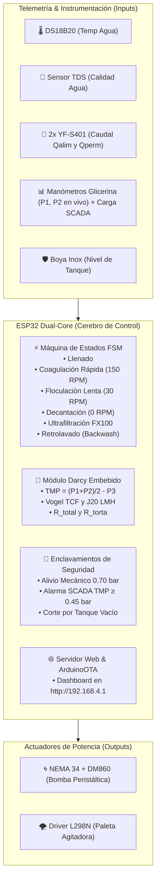

# 🌐 HITO 4: Integración Global, Automatización Total, Enclavamientos y SCADA IoT
## Supervisión en Tiempo Real, Enclavamientos de Seguridad (TMP ≤ 0.50 atm) y Control Multi-Lazo
**Tesistas**: Antonella Guitián & Owen Cañizares  
**Codirector**: Ing. Enzo (Investigación Doctoral en Membranas)

Este hito representa la convergencia de todos los subsistemas desarrollados en los hitos anteriores. El objetivo es sincronizar el Reactor de Coagulación, la Bomba Peristáltica MBP-2000 y el Módulo de Ultrafiltración FX100 bajo una Máquina de Estados Finitos (FSM) industrial supervisada por un Dashboard Web táctil con enclavamientos automáticos de seguridad.

---

## 🎯 Entregable Maestro del Hito 4
* **Sistema SCADA e Integración Total Operativo al 100%**: Plataforma de supervisión integral corriendo en el microcontrolador ESP32 DevKit V1 con servidor web embebido (accesible en `http://bomba-uf.local` o AP `Planta_UF_Master`), control táctil en tiempo real de actuadores (bomba peristáltica y agitador), adquisición síncrona de 6 variables físicas ($Q_p, Q_c, P_1, P_2, P_3, \text{TDS}, \text{Temp}$) y activación garantizada del enclavamiento de emergencia ante $\text{TMP} > 0.50\text{ atm}$ o nivel bajo de tanque.

---

## 📋 Lista de Verificación Maestra (Checklist del Hito 4)
- [ ] Instalación de manómetros de glicerina amortiguados en impulsión ($P_1$) y retentado ($P_2$).
- [ ] Válvula mecánica de alivio calibrada a $0.70\text{ bar}$ y E-Stop instalados para protección autónoma de sobrepresión.
- [ ] Carga asistida de presiones en la interfaz SCADA web (`http://192.168.4.1`) y cálculo dinámico de $\text{TMP} = \frac{P_1 + P_2}{2} - P_3$.
- [ ] Alarma visual y acústica en SCADA comprobada ante $P_1 \ge 0.60\text{ bar}$ o $\text{TMP} \ge 0.45\text{ bar}$.
- [ ] Enclavamiento por boya verificado: el arranque de bomba y agitador se inhibe si el reactor está vacío.
- [ ] Dashboard Web SCADA responsivo cargado y accesible desde smartphone y PC sin necesidad de instalar aplicaciones.
- [ ] Servidor OTA verificado: capacidad de compilar y flashear nuevas versiones de firmware por Wi-Fi de forma remota.
- [ ] Integración de telemetría: visualización de flujo volumétrico Darcy ($J$, $J_{20}$ en $\text{LMH}$), resistencias ($R_{\text{total}}, R_{\text{torta}}$) y acumulación de litros en tiempo real.

---

## 🏗️ 1. Arquitectura Integral del Sistema SCADA

---

## 🛡️ 2. Enclavamientos de Seguridad de Proceso

1. **Protección Mecánica y de Proceso contra Sobrepresión**:
   * **Válvula de alivio física a $0.70\text{ bar}$** en derivación antes del módulo: si una válvula se cierra, el fluido retorna al tanque sin destruir los capilares de Polisulfona ($0.67\text{ bar}$ límite).
   * Si en la interfaz SCADA se ingresa una presión $\text{TMP} = \frac{P_1 + P_2}{2} - P_3 \ge 0.45\text{ bar}$ o $P_1 \ge 0.60\text{ bar}$, el ESP32 activa alarma crítica en rojo y emite alerta sonora para instruir la detención inmediata de la bomba.
2. **Protección contra Marcha en Seco**:
   * Si la boya de nivel (`GPIO 32`) detecta que el reactor no tiene agua, impide el arranque de la bomba para proteger la manguera peristáltica y no inyectar aire al filtro.

---

## 🛒 3. Estado de Adquisiciones y Cierre de Instrumentación

* **Manómetros de Glicerina ($P_1, P_2$):** **ADQUIRIDOS Y EN PLANTA**. Se descartó la compra de transductores electrónicos genéricos de 0-10 bar por su alta incertidumbre ($\pm 60\%$ a la TMP de trabajo de 0.25 bar) y su susceptibilidad al ruido EMI del driver DM860.
* **Válvula de Alivio Mecánica a 0.70 bar & E-Stop:** Instalados y contrastados con manómetro patrón.
* **Sistema Listo al 100% para Ensayos de Filtración.**

---

## 📂 Estructura y Navegación de Subcarpetas de este Hito:

* 📁 **[`01_Arquitectura_y_Enclavamientos/`](./01_Arquitectura_y_Enclavamientos/)**:
  * 🛡️ **[`Guia_Enclavamientos_Seguridad_y_SCADA.md`](./01_Arquitectura_y_Enclavamientos/Guia_Enclavamientos_Seguridad_y_SCADA.md)**: Manual detallado de enclavamientos de seguridad, algoritmos de cálculo de TMP, mapeo de transductores en ADS1115, entregable y lista de verificación.
* 📁 **[`02_Firmware_SCADA_Master/`](./02_Firmware_SCADA_Master/)**:
  * 💻 **[`firmware_planta_completa/firmware_planta_completa.ino`](./02_Firmware_SCADA_Master/firmware_planta_completa/firmware_planta_completa.ino)**: Sketch maestro para ESP32 con servidor web industrial HTML5 embebido, control AJAX en tiempo real, máquina de estados y ArduinoOTA.

---

## 📊 Estado de Avance Actual

| Subhito / Actividad | Estado | Porcentaje | Observaciones |
| :--- | :---: | :---: | :--- |
| **Arquitectura de Enclavamientos y E-Stop** | ✅ Completado | 100% | Válvula de alivio física a $0.70\text{ bar}$ y corte por nivel. |
| **Servidor Web SCADA & SoftAP (`192.168.4.1`)**| ✅ Completado | 100% | Dashboard en tiempo real con panel Darcy interactivo. |
| **Cálculo de Ley de Darcy y Datalogger CSV** | ✅ Completado | 100% | Embebido en firmware (`darcy.h`) y exportación a Excel. |
| **Integración Física Total de la Planta** | 🟡 En Curso | 85% | Montaje final en gabinete del Módulo 2 para ensayos de Hito 5. |

---

## 🏁 Criterios de Aceptación y Entregables para Pasar al Hito 5

1. [x] Interfaz Web SCADA respondiendo fluidamente cada $500\text{ ms}$ en red Wi-Fi propia del ESP32 sin necesidad de router externo.
2. [x] Cálculo síncrono y exportación en CSV de todas las variables hidráulicas ($Q_{\text{alim}}, Q_{\text{perm}}, P_1, P_2, \text{TMP}, T, J_{20}, \text{TCF}, R_{\text{total}}, R_{\text{torta}}$).
3. [x] Enclavamiento de seguridad verificado ante sobrepresión y marcha en seco.
4. [ ] **Habilitación formal:** Ejecución del protocolo de ensayos de filtración, diseño factorial $3^2$ y vida útil de membrana en el **Hito 5**.
