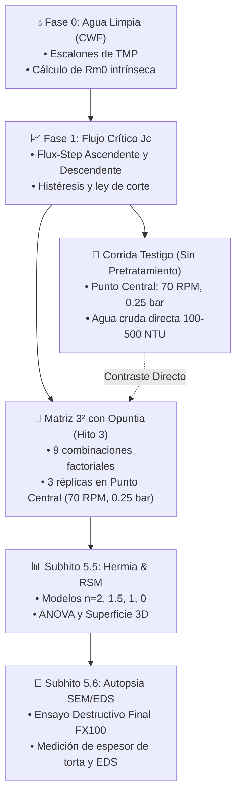

# 🧪 HITO 5: Ensayos Experimentales de Ultrafiltración FX100, Modelado Darcy y Vida Útil
## Modelado de Fenómenos de Transporte, Ensuciamiento (Fouling), Eficiencia de Retrolavado y Calidad de Agua
**Tesistas**: Antonella Guitián & Owen Cañizares  
**Codirector**: Ing. Enzo (Investigación Doctoral en Membranas)

Este hito representa el cierre científico y experimental de la tesis de grado y su vinculación directa con la Beca Doctoral. Su objetivo es ejecutar ensayos sistemáticos de filtración con agua sintética turbia, validar la efectividad del pretratamiento por coagulación-sedimentación, calcular los parámetros de la Ley de Darcy y diseñar la estrategia de operación que maximice la vida útil de la membrana Fresenius FX100 obteniendo agua potable según la norma del Código Alimentario Argentino (CAA).

---

## 🎯 Entregable Maestro del Hito 5
* **Resultados experimentales, validación del modelo de Darcy y capítulo de resultados de tesis completo**: Determinación de la resistencia intrínseca ($R_m$), cinética de ensuciamiento ($R_{torta}$ y $R_{irrev}$), cálculo del Índice de Recuperación de Flujo post-retrolavado ($FRR \ge 90\%$), cumplimiento de los parámetros de agua potable del Código Alimentario Argentino (CAA Art. 982) y consolidación de gráficas de alta resolución para el informe final de tesis.

---

## 📋 Lista de Verificación Maestra (Checklist del Hito 5)
- [ ] Membrana Fresenius FX100 purgada y montada verticalmente con conexiones libres de aire.
- [ ] Ensayo con agua limpia (CWF) ejecutado a 4 escalones de TMP para determinar $R_{m,0}$ basal ($R^2 \ge 0.985$).
- [ ] Ensayo de flujo crítico escalonado ($J_c$) completado con histéresis ascendente y descendente.
- [ ] **Corrida Testigo sin Pretratamiento (Agua Cruda Directa)** ejecutada en el Punto Central ($70\text{ RPM}, 0.25\text{ bar}$).
- [ ] **3 Réplicas en Punto Central con Pretratamiento de *Opuntia*** completadas para estimar varianza residual pura y curvatura.
- [ ] Cuantificación de $\Delta R_{\text{torta}}$, pendiente de caída $J(t)/J_0$ y mejora del Factor de Recuperación de Flujo ($FRR$).
- [ ] Matriz factorial completa $3^2$ (13 corridas en total con recirculación de permeado) registrada en datalogger CSV.
- [ ] **Subhito 5.5**: Ajuste de los 4 modelos cinéticos de bloqueo de Hermia ($n=2, 1.5, 1, 0$) y modelado por Superficie de Respuesta (RSM 3D / ANOVA).
- [ ] **Subhito 5.6**: Autopsia destructiva post-mortem en Microscopio Electrónico de Barrido (SEM / EDS) para medir el espesor de torta $\delta_c\ [\mu\text{m}]$ y correlacionarlo con $R_{\text{torta}}$.
- [ ] Cumplimiento de parámetros de calidad de agua permeada verificado contra el Código Alimentario Argentino (CAA Art. 982).

---

## 📚 1. Modelo Matemático de Fenómenos de Transporte (Ley de Darcy)

El flujo volumétrico específico a través de los capilares de Polisulfona ($J$) se rige por la Ley de Darcy modificada para membranas de fibra hueca:

$$J = \frac{Q_p}{A_m} = \frac{\text{TMP}}{\mu(T) \cdot R_{\text{total}}} \quad \left[\frac{\text{L}}{\text{m}^2\cdot\text{h}}\right]$$

Donde la resistencia hidráulica total ($R_{\text{total}}$) se descompone en resistencias en serie:

$$R_{\text{total}} = R_m + R_{\text{torta}} + R_{\text{irrev}}$$

* $A_m$: Área interfacial efectiva de la membrana FX100 ($2.2\text{ m}^2$).
* $\mu(T)$: Viscosidad dinámica del agua a la temperatura de ensayo ($\text{Pa}\cdot\text{s}$), calculada con la ecuación de Vogel.
* $J_{20}$: Flujo normalizado a $20^\circ\text{C}$ mediante el factor $\text{TCF}(T) = \mu(T)/\mu_{20}$.
* $R_m$: Resistencia intrínseca de la membrana limpia ($\text{m}^{-1}$).
* $R_{\text{torta}}$: Resistencia por acumulación de flóculos y partículas sobre la pared capilar.
* $R_{\text{irrev}}$: Resistencia irreversible por adsorción o bloqueo de microporos.

---

## 🧪 2. Protocolo de Ensayos Experimentales y Vinculación Hito 3 ◄► Hito 5

### Contraste Científico Central de la Tesis:
* **Corrida Testigo (Control sin Pretratamiento):** Agua sintética turbia sin coagulante alimentada a $70\text{ RPM}$ y $\text{TMP} = 0.25\text{ bar}$. Se registra la velocidad acelerada de colmatación y colapso de flujo.
* **3 Réplicas del Punto Central con *Opuntia ficus-indica*:** Agua pretratada en el sedimentador cónico con dosis óptima de biocoagulante alimentada a las mismas condiciones ($70\text{ RPM}, 0.25\text{ bar}$).
* **Métricas Comparativas Inmediatas:**
  $$\Delta R_{\text{torta}} = R_{\text{torta, cruda}} - R_{\text{torta, Opuntia}}$$
  $$\text{Atenuación de Colmatación} = \left(1 - \frac{(dR/dt)_{\text{Opuntia}}}{(dR/dt)_{\text{cruda}}}\right) \times 100\% \ge 70\%$$
  $$\Delta FRR = FRR_{\text{Opuntia}} - FRR_{\text{cruda}} \ge +20\%$$

---

## 📈 3. Subhito 5.5: Modelado Cinético de Hermia y Optimización Factorial (RSM)
* **Modelos de Bloqueo de Hermia:** Ajuste sobre las series temporales de $J(t)$ registradas cada 10 s en los CSV:
  1. Bloqueo Completo ($n=2.0$): $\ln(J/J_0) = -k_b t$.
  2. Bloqueo Estándar ($n=1.5$): $1/\sqrt{J} - 1/\sqrt{J_0} = k_s t$.
  3. Bloqueo Intermedio ($n=1.0$): $1/J - 1/J_0 = k_i t$.
  4. Formación de Torta ($n=0.0$): $1/J^2 - 1/J_0^2 = 2 k_c t$.
* **Superficie de Respuesta (RSM 3D) y ANOVA:** Construcción del metamodelo polinomial de segundo orden para optimizar la combinación $(\text{RPM}^*, \text{TMP}^*)$ que maximiza el volumen neto de filtración.

---

## 🔬 4. Subhito 5.6: Autopsia Morfológica Post-Mortem SEM / EDS (Fresenius FX100)
* **Ubicación Temporal Mandatoria:** Estrictamente al **finalizar todas las campañas experimentales** (ensayo destructivo).
* **Protocolo de Microscopía Electrónica de Barrido:**
  1. **Corte Transversal Criogénico (*Cross-section*):** Medición micrométrica directa del espesor de la torta coloidal ($\delta_c\ [\mu\text{m}]$) sobre la pared capilar asimétrica ($185\ \mu\text{m}$ DI, $35\ \mu\text{m}$ pared) para contrastarla contra $R_{\text{torta}}$ de Darcy.
  2. **Superficie Luminal Interna:** Micrografías comparativas (Virgen vs. Ensuciada vs. Post-retrolavado) que explican físicamente $R_{\text{irrev}}$.
  3. **Perfil Axial:** Evaluación longitudinal de polarización por concentración en entrada, centro y salida del cartucho.
  4. **Microanálisis EDS:** Picos inorgánicos (Si, Al, Fe, Ca, Mg) vs. picos orgánicos del biopolímero *Opuntia* (C, O).

---

## 📂 Estructura y Navegación de Subcarpetas de este Hito:

* 🗺️ **[`HOJA_DE_RUTA_DESARROLLO_Y_ENSAYOS.md`](../HOJA_DE_RUTA_DESARROLLO_Y_ENSAYOS.md)**: **Documento Maestro de Ingeniería**. Detalle de la matriz factorial completa $3^2$, flujo crítico escalonado $J_c$, modelado cinético y protocolo de limpieza con NaOCl.
* 📁 **[`01_Protocolo_Ensayos_Darcy_y_Fouling/`](./01_Protocolo_Ensayos_Darcy_y_Fouling/)**:
  * 🧪 **[`Protocolo_Ensayos_Darcy_y_VidaUtil.md`](./01_Protocolo_Ensayos_Darcy_y_Fouling/Protocolo_Ensayos_Darcy_y_VidaUtil.md)**: Protocolo científico exhaustivo de ensayos de ultrafiltración, factor de temperatura TCF, resistencias en serie y tabla comparativa del Código Alimentario Argentino (CAA).
* 📁 **[`02_Planillas_y_Datos_Tesis/`](./02_Planillas_y_Datos_Tesis/)**:
  * 📊 **[`Guia_Analisis_Datos_Graficos_Tesis.md`](./02_Planillas_y_Datos_Tesis/Guia_Analisis_Datos_Graficos_Tesis.md)**: Guía metodológica con scripts de Python para generación automática de figuras científicas vectoriales ($300\text{ DPI}$).
  * 📑 **[`plantilla_datos_ensayo_tesis.csv`](./02_Planillas_y_Datos_Tesis/plantilla_datos_ensayo_tesis.csv)**: Matriz de datos experimental con telemetría de caudales, presiones manométricas, flujos y resistencias.
* 📁 **[`03_Modelado_Hermia_y_Optimizacion_RSM/`](./03_Modelado_Hermia_y_Optimizacion_RSM/)**:
  * 📈 **[`Guia_Modelado_Hermia_y_Superficie_Respuesta.md`](./03_Modelado_Hermia_y_Optimizacion_RSM/Guia_Modelado_Hermia_y_Superficie_Respuesta.md)**: Protocolo de regresión para los 4 modelos de Hermia, ANOVA factorial y generación de gráficos 3D.
* 📁 **[`04_Autopsia_SEM_EDS_Fibras_Helixone/`](./04_Autopsia_SEM_EDS_Fibras_Helixone/)**:
  * 🔬 **[`Protocolo_Autopsia_SEM_EDS_Membrana_FX100.md`](./04_Autopsia_SEM_EDS_Fibras_Helixone/Protocolo_Autopsia_SEM_EDS_Membrana_FX100.md)**: Protocolo de fractura criogénica en nitrógeno líquido, metalizado, adquisición SEM y microanálisis EDS.
