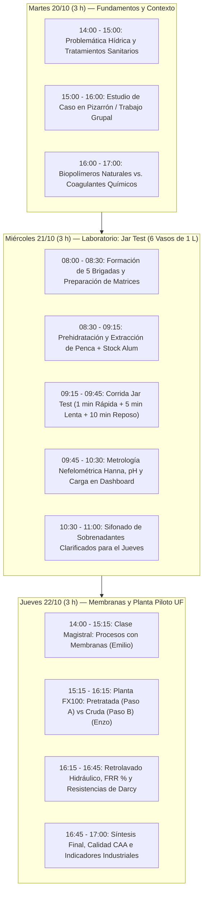
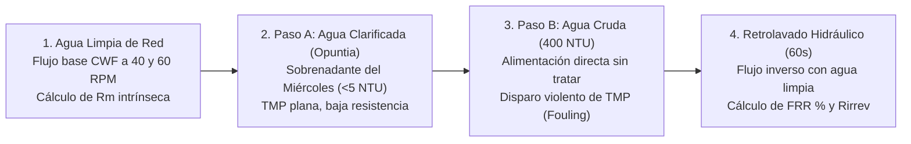

# 🎓 PLANIFICACIÓN INTEGRAL DE CURSO / TALLER
## XXIX CoNEIQ Salta 2026 — Congreso Nacional de Estudiantes de Ingeniería Química
### *"Tratamiento Avanzado y Sustentable de Aguas: Sinergia entre Biocoagulantes Naturales (Opuntia ficus-indica) y Separación por Membranas de Ultrafiltración (UF)"*

---

**Docentes / Disertantes Responsables:**
* **Dr. Ing. Emilio Almazán** (Profesor / Investigador UNSa)
* **Ing. Enzo Corte** (Investigador Doctoral — Tesis Doctoral en Procesos de Membranas / UNSa - INIQUI)

**Audiencia:** 30 Estudiantes inscriptos de Ingeniería Química de todo el país.  
**Estructura del Curso:** 5 Brigadas de 6 estudiantes para los ensayos de coagulación + 1 Puesto de Control Docente (Blanco).  
**Recurso Hídrico Utilizado:** 100% Agua de Red local (no se requiere agua destilada; simula condiciones reales de potabilización descentralizada).  
**Recipientes Disponibles:** 6 Vasos de precipitado de 1000 mL (1 Litro).

---

## 🧭 1. Resumen Ejecutivo y Dinámica de Coordinación

### 1.1. ¿Por qué 3 horas el Miércoles?
> **Veredicto:** **3 HORAS COMPLETAS son indispensables.**  
> Con 30 estudiantes divididos en brigadas, el miércoles requiere:
> 1. Recepción, seguridad química y conformación de 5 brigadas de 6 alumnos (15 min).
> 2. Pesada y dispersión individual de arcilla en los vasos de 1 Litro (25 min).
> 3. Extracción mecánica suave de hidrogel de *Opuntia* y preparación de stock de sulfato al 1% en agua de red (25 min).
> 4. Corrida del *Jar Test* de 16 minutos (1 min rápida + 5 min lenta + 10 min sedimentación) (20 min).
> 5. Muestreo nefelométrico con turbidímetro Hanna, medición de pH, cálculo de eficiencias ($\text{RT}\%$) y subida de datos a planilla compartida (45 min).
> 6. Trasvase y rotulado de los sobrenadantes para alimentar la planta de UF el jueves + limpieza (30 min).  
> **Total: 160 - 180 min.** Menos tiempo impediría que todos los alumnos operen los instrumentos.

### 1.2. ¿Cómo estructurar el Jueves de Ultrafiltración? (50% Aula / 50% Planta)
> * **Bloque 1 (14:00 - 15:15 | 75 min) — Teoría de Membranas (Dr. Emilio Almazán):**  
>   Fundamentos de separación por membrana, microfiltración vs ultrafiltración, fuerzas impulsoras, analogía con Ley de Ohm (Darcy), resistencias en serie, cinéticas de Hermia y diferencias constructivas entre **Fibra Hueca** y **Membrana Plana**.
> * **Bloque 2 (15:15 - 17:00 | 105 min) — Taller Experimental en Planta Piloto FX100 (Ing. Enzo Corte):**  
>   Puesta en marcha de la planta mecatrónica (bomba peristáltica NEMA 34 + SCADA Web ESP32).  
>   *Estrategia de protección de membrana:* Se filtra **primero el agua clarificada con penca/sulfato** (TMP estable y baja) y **después el agua cruda** (para mostrar el disparo de presión y colapso de flujo sin arruinar la membrana al inicio), concluyendo con el retrolavado y cálculo de $FRR\%$.

---

## 📅 2. Cronograma General del Curso



---

## 🧪 3. Miércoles 21/10: Laboratorio de Clarificación (Jar Test de 1 Litro)

### 3.1. ¿Por qué hacemos la Prehidratación Estática de la Penca (15-20 min)?

> [!NOTE]
> **Fundamentación Biológica y Reológica:**  
> En el cladodio fresco poscosecha, el mucílago está confinado en conductos laticíferos y células mucilaginosas en forma de gel semiseco altamente concentrado.  
> 1. **Hinchamiento osmótico (*swelling*):** Al sumergir los cubos trozados en agua durante 15–20 minutos, el tejido vegetal absorbe agua libre (registrando una ganancia de peso $\approx 50\%$, ver manuscrito). El agua penetra la matriz celular y relaja las fuerzas intermoleculares del mucílago.
> 2. **Desprendimiento sin fractura:** Las cadenas macromoleculares de ácido galacturónico se desenrollan y se despegan de las paredes rígidas de celulosa y lignina.
> 3. **Liberación con bajo cizallamiento:** Gracias a esta hidratación previa, bastan **6 pulsos suaves de 2 segundos** para que el hidrogel íntegro se disuelva en el agua de red. Si se intentara licuar en seco o sin prehidratar, se requeriría una molienda agresiva que rompería covalentemente las cadenas largas del biopolímero (*despolimerización mecánica*), perdiendo su capacidad floculante.

---

### 3.2. Cuadro Comparativo Detallado: Sulfato de Aluminio vs. Penca (*Opuntia ficus-indica*)

Para explicar a los estudiantes durante el práctico:

| Criterio Técnico | Coagulante Convencional: Sulfato de Aluminio $[Al_2(SO_4)_3 \cdot 18H_2O]$ | Biocoagulante Natural: Penca de Tuna (*Opuntia ficus-indica*) |
| :--- | :--- | :--- |
| **Mecanismo Dominante** | **Neutralización de carga y Floculación por barrido:** Los cationes $Al^{3+}$ e hidróxidos poliméricos comprimen la doble capa eléctrica del coloide y precipitan como manto gelatinoso de $Al(OH)_3\downarrow$. | **Adsorción y Formación de Puentes Poliméricos (*Bridging*):** Las largas cadenas macromoleculares de poligalacturonatos exponen grupos $-OH$ y $-COO^-$ que atrapan coloides simultáneamente. |
| **Efecto sobre el pH** | **Ácido ($\Delta\text{pH} \approx -0.8 \text{ a } -1.2$):** Libera iones hidronio ($H^+$) al medio: $Al^{3+} + 3H_2O \rightleftharpoons Al(OH)_3\downarrow + 3H^+$. Consume la alcalinidad natural del agua. | **Neutro ($\Delta\text{pH} \approx 0$):** Polielectrolito orgánico de origen natural; no consume alcalinidad ni altera significativamente el pH del agua tratada. |
| **Volumen y Calidad del Lodo** | Lodo químico gelatinoso, muy hidratado, voluminoso, de difícil deshidratación física y clasificado como residuo especial con riesgo de lixiviación de aluminio. | Lodo biológico compacto, de rápida deshidratación natural, 100% biodegradable, no tóxico y potencialmente compostable para suelos. |
| **Impacto de la Sobredosificación** | **Inversión de carga:** Exceso de cationes $Al^{3+}$ otorga carga neta positiva a los coloides, reestabilizando la suspensión y acidificando peligrosamente el agua. | **Impedimento Estérico (*Steric Hindrance*):** El exceso de mucílago recubre por completo cada coloide de arcilla de forma individual, impidiendo que formen puentes entre sí, dejando agua turbia y con DQO soluble residual. |
| **Salinidad / TDS** | Incrementa los sólidos disueltos totales (TDS) aportando aniones sulfato ($SO_4^{2-}$) y cationes residuales, elevando la conductividad eléctrica. | Prácticamente no aporta iones minerales libres; mantiene la conductividad basal del agua de red. |
| **Aspecto Visual del Flóculo** | Flóculos pequeños a medianos, densos, de color blancuzco/grisáceo que decantan rápidamente. | Macroflóculos grandes, filamentosos, ramificados y de estructura abierta ("red de telaraña"). |

---

### 3.3. Diseño de la Batería de Ensayos para 30 Inscriptos (Vasos de 1000 mL)

Organización pedagógica:
* **Vaso 1 (Docente / Control):** Operado por Emilio y Enzo para que los 30 alumnos vean la línea base de la decantación natural en alta turbidez (sin coagulante), sin hacer perder tiempo a ninguna brigada.
* **Vasos 2 al 6 (Brigadas 1 a 5):** 5 grupos de 6 alumnos, cada uno a cargo de una jarra activa.
* **La Sobredosis de Penca se hace en Baja Turbidez (Vaso 4):** Tal como solicitaste, en baja turbidez ($1.0\text{ g/L}$) la sobredosis ($1.8\text{ g/L}$) es **extremadamente visible y contrastante**: mientras el Vaso 3 (óptimo de penca) queda 100% cristalino ($<3\text{ NTU}$), el Vaso 4 (sobredosis) queda notablemente opaco, lechoso y viscoso por impedimento estérico.

#### Cuadro Maestro de Dosificación en Vasos de 1000 mL (1 Litro de Agua de Red)

| Vaso | Asignación | Matriz en Vaso (1 L) | Turb. Est. | Coagulante | Dosis Equivalente | ¿Cuánto agregar al Minuto 0? |
| :---: | :---: | :---: | :---: | :---: | :---: | :---: |
| **V1** | **Docentes (Control)** | $1000\text{ mL} + 4.0\text{ g}$ arcilla | $\approx 450\text{ NTU}$ | **Blanco** | $0\text{ mg/L}$ | **Nada ($0\text{ mL}$)** |
| **V2** | **Brigada 1 (6 alumnos)** | $1000\text{ mL} + 1.0\text{ g}$ arcilla | $\approx 120\text{ NTU}$ | **Sulfato de Aluminio** | $20\text{ mg/L}$ | **$2.0\text{ mL}$** de solución stock al 1% |
| **V3** | **Brigada 2 (6 alumnos)** | $1000\text{ mL} + 1.0\text{ g}$ arcilla | $\approx 120\text{ NTU}$ | **Penca (*Opuntia*)** | $0.5\text{ g/L}$ | **$0.50\text{ g}$** de hidrogel fresco |
| **V4** | **Brigada 3 (6 alumnos)** | $1000\text{ mL} + 1.0\text{ g}$ arcilla | $\approx 120\text{ NTU}$ | **Penca (SOBREDOSIS)** | $1.8\text{ g/L}$ | **$1.80\text{ g}$** de hidrogel fresco *(Visual!)* |
| **V5** | **Brigada 4 (6 alumnos)** | $1000\text{ mL} + 4.0\text{ g}$ arcilla | $\approx 450\text{ NTU}$ | **Sulfato de Aluminio** | $40\text{ mg/L}$ | **$4.0\text{ mL}$** de solución stock al 1% |
| **V6** | **Brigada 5 (6 alumnos)** | $1000\text{ mL} + 4.0\text{ g}$ arcilla | $\approx 450\text{ NTU}$ | **Penca (*Opuntia*)** | $0.6\text{ g/L}$ | **$0.60\text{ g}$** de hidrogel fresco |

> [!TIP]
> **Preparación de Reactivos con Agua de Red (Sin destilada):**
> * **Solución Stock de Sulfato al 1% p/v ($10\text{ mg/mL}$):** Disolver **$2.50\text{ g}$** de Sulfato de Aluminio puro en **$250\text{ mL}$** de agua de red (o $1.00\text{ g}$ en $100\text{ mL}$).
> * **Pesada de Penca Fresca:** Pesar cubitos de hidrogel en barquetas de pesada ($0.50\text{ g}$, $1.80\text{ g}$ y $0.60\text{ g}$).

---

### 3.4. Cronómetro Operativo de Corrida (Ciclo de 16 Minutos)

```
[00:00 - 01:00]  MEZCLA RÁPIDA: 150 RPM (1 min)  --> Dosificación simultánea de reactivos
[01:00 - 06:00]  MEZCLA LENTA:   25 - 30 RPM (5 min) --> Crecimiento de macroflóculos (ortocinética)
[06:00 - 16:00]  SEDIMENTACIÓN:   0 RPM (10 min) --> Reposo total (precipitación por Ley de Stokes)
[16:00 en adel.] MEDICIÓN:       Toma de muestra a 2 cm de profundidad y lectura en HANNA
```

1. **Minuto 0 a 1 (150 RPM):** Encender las 6 paletas. Las brigadas agregan simultáneamente sus reactivos. Dispersión macromolecular homogénea y desestabilización electrostática.
2. **Minuto 1 a 6 (25 - 30 RPM):** Reducir velocidad. Los estudiantes observan la agregación ortocinética.
3. **Minuto 6 a 16 (0 RPM):** Apagar el motor y subir suavemente las paletas. Reposo estático de 10 minutos.
4. **Minuto 16 (Medición Nefelométrica Hanna):**
   * Con pipeta volumétrica o jeringa limpia, tomar muestra del sobrenadante a **$2\text{ cm}$ por debajo de la superficie**.
   * Llenar celda limpia, pasar pañuelo tissue suave, alinear con la flecha y presionar `READ`.
5. **Acondicionamiento para el Jueves:**  
   Trasvasar con sifón **$600\text{ a }700\text{ mL}$** de los sobrenadantes de **V2, V3 y V5**, y reservar una muestra de **Agua Cruda ($400\text{ NTU}$)**. Guardar en botellas rotuladas.

---

## ⚡ 4. Jueves 22/10: Teoría y Práctico en Planta Piloto de Ultrafiltración

### 4.1. Marco Teórico: Fenómenos de Transporte y Membranas (Dr. Emilio Almazán)

#### A. Ley de Darcy y Resistencias en Serie (Analogía con la Ley de Ohm)
Para explicárselo intuitivamente a los alumnos:
$$J = \frac{Q_p}{A_m} = \frac{\text{TMP}}{\mu(T) \cdot R_{\text{total}}}$$

* **Analogía Eléctrica:**  
  * La **Presión Transmembrana ($\text{TMP}$)** es el **Voltaje ($\Delta V$)**: la fuerza impulsora que empuja el fluido.
  * El **Flujo específico ($J$)** es la **Corriente ($I$)**: la velocidad a la que atraviesa el agua permeada.
  * La **Resistencia hidráulica total ($R_{\text{total}}$)** es la **Resistencia eléctrica ($R$)**: la oposición que encuentran las moléculas de agua.
  * La **Viscosidad dinámica ($\mu(T)$)** actúa como un factor de fricción térmica: a mayor temperatura, el agua es más fluida y fluye más rápido.

* **Descomposición de Resistencias:**
  $$R_{\text{total}} = R_m + R_{\text{torta}} + R_{\text{irrev}}$$
  * **$R_m$ (Resistencia Intrínseca de la Membrana):** Resistencia hidrodinámica del material limpio (Helixone® microporoso). Es constante y propia de la fabricación.
  * **$R_{\text{torta}}$ (Resistencia Reversible de Torta / Cake Layer):** Partículas de arcilla y flóculos que forman una capa sobre la superficie externa de la fibra. **Se remueve con retrolavado hidráulico.**
  * **$R_{\text{irrev}}$ (Resistencia Irreversible / Adsorción de Poros):** Partículas finas o materia orgánica coloidal que penetran en la garganta del poro y quedan atrapadas químicamente. **No sale con agua; exige limpieza química (CIP).**

---

#### B. Módulo de Fibra Hueca (*Hollow Fiber*) vs. Membrana Plana (*Flat Sheet* / Placa)
*(Aprovechando los dos ejemplares que tienes en el laboratorio para mostrarles físicamente):*

```
     MEMBRANA DE FIBRA HUECA (FX100)                     MEMBRANA PLANA (PLACA Y MARCO)
   ┌───────────────────────────────────┐               ┌───────────────────────────────────┐
   │ Miles de capilares agrupados      │               │ Lámina polimérica sobre soporte   │
   │ Densidad > 10.000 m²/m³           │               │ Densidad 100 - 400 m²/m³          │
   │ RESISTE RETROLAVADO (Backwash)    │               │ NO tolera retrolavado a presión   │
   │ Flujo laminar interno definido    │               │ Requiere espaciadores (mallas)    │
   │ Estándar industrial potabilización│               │ Típica de laboratorio / MBR       │
   └───────────────────────────────────┘               └───────────────────────────────────┘
```

1. **Densidad de Empaque (Área por volumen):**  
   * En la **Fibra Hueca (FX100)**, empaquetando miles de capilares de $185\ \mu\text{m}$, se logran **$2.2\text{ m}^2$ de área de filtración en un cilindro de apenas 30 cm**. En membrana plana, para obtener $2.2\text{ m}^2$ se requeriría una placa gigante o un sistema de placas y marcos aparatoso.
2. **Capacidad de Retrolavado Hidráulico (*Backwashability*):**  
   * La **Fibra Hueca** tolera perfectamente invertir el flujo hidráulico (inyectar agua a contracorriente desde el permeado hacia el lumen) expandiendo ligeramente el capilar y desprendiendo la torta de lodo.
   * La **Membrana Plana** no se puede retrolavar a presión desde el permeado porque se despega, deforma o desgarra de su soporte poroso; depende exclusivamente de la limpieza por cizallamiento tangencial en superficie o lavado químico.
3. **Hidrodinámica y Espaciadores:**  
   * La fibra hueca tiene canales tubulares lisos y uniformes. La membrana plana requiere mallas plásticas separadoras (*feed spacers*) que promueven turbulencia pero atrapan sólidos en sus cruces, facilitando el bioensuciamiento.

---

#### C. ¿Por qué se utiliza una Bomba Peristáltica y no una Bomba Centrífuga barata?

| Parámetro Comparativo | Bomba Peristáltica (NEMA 34 Paso a Paso) | Bomba Centrífuga Convencional |
| :--- | :--- | :--- |
| **Principio de Bombeo** | **Desplazamiento Positivo Determinístico:** Cada revolución desplaza un volumen exacto y fijo de fluido ($mL/\text{rev}$). | **Cinética Hidrodinámica:** El caudal depende fuertemente de la contrapresión del sistema (curva $H-Q$). |
| **Comportamiento ante el Ensuciamiento de Membrana** | **Mantiene el caudal constante ($Q = \text{cte}$):** A medida que la membrana se colmata y la resistencia $R_{\text{total}}$ sube, la bomba eleva la presión suavemente permitiendo graficar $\text{TMP}(t)$ y modelar Darcy con rigor científico. | **El caudal se desploma:** Al subir la resistencia de la membrana, la centrífuga se corre en su curva hacia caudal casi nulo ($Q \rightarrow 0$), haciendo imposible medir cinéticas de ensuciamiento controladas. |
| **Esfuerzo de Corte sobre los Flóculos (*Shear Stress*)** | **Muy bajo cizallamiento:** Gira a bajas RPM ($20 - 80\text{ RPM}$) con compresión ondulante suave. **Preserva la estructura de los macroflóculos de penca.** | **Altísimo cizallamiento violento:** El rodete gira a $2800\text{ RPM}$, triturando los flóculos en micropartículas que penetran y arruinan los poros de la membrana. |
| **Estanqueidad y Contaminación** | **Aislamiento absoluto:** El fluido solo entra en contacto con la manguera de silicona grado médico. Sin sellos mecánicos, empaquetaduras ni lubricantes. | Posee sellos mecánicos y cámara metálica propensa a fugas, desgaste abrasivo con arcillas y contaminación del agua tratada. |
| **Inversión de Giro** | Invierte el flujo en milisegundos por software para purga o retrolavado. | No puede girar en reversa de forma operativa. |

---

### 4.2. Bloque Experimental en Planta Piloto FX100 (Ing. Enzo Corte)

#### Estrategia Operativa de Ensayos (Para no dañar la membrana):
> [!IMPORTANT]
> **Orden Riguroso de la Corrida:**  
> 1. **Línea Base:** Agua limpia de red para determinar $R_m$ intrínseca.  
> 2. **Paso A (PRIMERO):** Alimentar **Agua Pretratada con Opuntia** ($<5\text{ NTU}$). La membrana opera con bajísima resistencia y TMP plana.  
> 3. **Paso B (SEGUNDO):** Alimentar **Agua Cruda Directa ($400\text{ NTU}$)**. Se observa el rápido ensuciamiento y salto de presión sin haber condicionado el ensayo previo.  
> 4. **Paso C:** Retrolavado y evaluación de recuperación ($FRR\%$).



#### 1. Ensayo 1: Flujo de Agua Limpia y Determinación de $R_m$
* Bombear agua de red limpia a $40\text{ RPM}$ ($Q \approx 0.168\text{ L/min}$) y luego $60\text{ RPM}$ ($Q \approx 0.252\text{ L/min}$).
* Medir presiones manométricas en entrada ($P_1$) y retentado ($P_2$), con permeado a presión atmosférica ($P_{\text{perm}} = 0$).
* Calcular la Presión Transmembrana:
  $$\text{TMP} = \frac{P_1 + P_2}{2}$$
* Determinar en vivo la resistencia intrínseca de la membrana limpia ($R_m$):
  $$R_m = \frac{\text{TMP}}{\mu \cdot J} \quad \left[\text{m}^{-1}\right]$$
  *(Valor de referencia esperado en FX100: $\approx 1.2 \times 10^{11} \text{ m}^{-1}$)*.

#### 2. Ensayo 2 — Paso A: Filtración de Agua Clarificada con *Opuntia* (Sobrenadante del Miércoles)
* Alimentar el agua clarificada del Vaso 3 ($< 5\text{ NTU}$).
* Los alumnos observarán en la pantalla del SCADA Web que la $\text{TMP}$ permanece prácticamente constante y el flujo $J$ se sostiene en el tiempo.
* *Lección:* **El biocoagulante eliminó más del 95% de los coloides suspendidos**, actuando como un escudo protector que evita el taponamiento de los poros capilares.

#### 3. Ensayo 2 — Paso B: Filtración de Agua Cruda Directa ($400\text{ NTU}$)
* Alimentar la muestra de agua cruda sin tratar.
* En cuestión de minutos, la aguja del manómetro $P_1$ sube visiblemente y en el SCADA la gráfica de $\text{TMP}$ muestra una pendiente pronunciada ($\frac{d\text{TMP}}{dt} \gg 0$).
* *Lección:* La gran masa de partículas de arcilla colisiona directamente contra la entrada de los capilares ($185\ \mu\text{m}$), produciendo bloqueo de poros y formación acelerada de torta densa (Modelos de Hermia $n=2$ y $n=1.5$).

---

#### 4. Ensayo 3: Retrolavado Hidráulico e Índice de Recuperación de Flujo ($FRR\%$)

> [!NOTE]
> **Explicación Teórica para los Alumnos: Fouling Reversible vs. Irreversible:**  
> * **Fouling Reversible ($R_{\text{torta}}$):** Masa de partículas posada sobre la cara exterior de los poros que se desprende fácilmente invirtiendo el sentido del flujo.
> * **Fouling Irreversible ($R_{\text{irrev}}$):** Bloqueo interno dentro de la matriz polimérica que no sale con agua y determina el deterioro de la membrana a largo plazo.

* **Procedimiento:** Inyectar agua limpia a contracorriente durante $60\text{ segundos}$.
* **Medición Post-Lavado:** Medir el nuevo flujo de agua limpia alcanzado ($J_{\text{post}}$).
* **Cálculo del FRR%:**
  $$FRR (\%) = \left(\frac{J_{\text{post}}}{J_{\text{inicial}}}\right) \times 100$$
  * Si $FRR \ge 90\%$: El ensuciamiento fue prácticamente reversible (comportamiento típico del agua clarificada con *Opuntia*).
  * Si $FRR < 65\%$: Existió taponamiento irreversible severo (comportamiento del agua cruda directa).

#### 5. Ensayo 4: Verificación de Calidad de Agua según CAA
* Tomar una muestra de agua permeada (filtrada por el módulo FX100).
* Medir en el turbidímetro Hanna: el permeado arrojará **$< 0.3 - 0.5\text{ NTU}$**.
* Conclusión de Ingeniería Sanitaria: Se cumple holgadamente con el **Código Alimentario Argentino (CAA Art. 982)** que exige $< 3\text{ NTU}$ en agua de red para consumo humano.

---

## 📦 5. Inventario de Materiales (100% Agua de Red)

* **Vasos de precipitado:** 6 vasos de 1000 mL de forma alta.
* **Agua:** Agua corriente de red de canilla del laboratorio (30 Litros disponibles).
* **Sedimento:** Arcilla o bentonita tamizada ($< 45\ \mu\text{m}$, malla #325): 200 g.
* **Reactivo Convencional:** Sulfato de Aluminio puro (Química Valfer): 1 frasco de 250 g.
* **Reactivo Biológico:** 2 a 3 cladodios frescos de *Opuntia ficus-indica* (penca de tuna).
* **Instrumental:** Turbidímetro portátil HANNA con celdas de vidrio limpias, peachímetro, minipimer de inmersión manual, balanzas, pipetas graduadas de 5 y 10 mL y propipetas.
* **Planta Piloto:** Bastidor con módulo Fresenius FX100, bomba peristáltica MBP-2000 con motor NEMA 34, manómetros de glicerina calibrados y control IoT ESP32.
