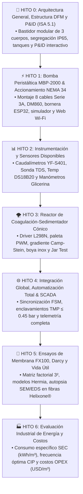

# 💧 PLANTA PILOTO DE ULTRAFILTRACIÓN INDUSTRIAL (FX100) & REACTOR DE COAGULACIÓN-SEDIMENTACIÓN
## Manual General del Proyecto, Arquitectura del Sistema y Guía de Navegación por Hitos

---

## 👥 Equipo de Trabajo & Contexto Académico

* **Codirector de Tesis**: **Ing. Enzo** *(Investigador Doctoral — Aplicación en Tesis Doctoral de Tratamiento de Aguas y Procesos de Separación por Membranas)*.
* **Tesistas de Grado (Ingeniería Industrial)**:
  * **Antonella Guitián**
  * **Owen Cañizares**
* **Objetivo Académico Conjunto**:
  Desarrollar, instrumentar y automatizar integralmente una planta piloto mecatrónica de tratamiento de agua que combine un **Reactor Floculador-Sedimentador Cónico** con un módulo de **Ultrafiltración Capilar de Fibra Hueca (Fresenius FX100)**, evaluando la cinética de ensuciamiento (*fouling*), modelando la Ley de Darcy y optimizando la vida útil de la membrana mediante control en tiempo real e IoT.

---

## 🗺️ Mapa de Navegación de los 7 Hitos de Trabajo (Consolidado)

Cada hito cuenta con su propia carpeta autocontenida con documentación técnica, esquemas de conexión, firmware compilado y probado, simuladores o plantillas de datos:



---

## 🧭 ¿Qué se busca y qué encontrarán en cada carpeta?

> [!NOTE]
> **Estado Técnico Real de los Hitos en Taller / Laboratorio:**
> * **Hito 0 (25% — En Diseño Preliminar):** Se definieron los diagramas conceptuales y P&ID; la estructura del bastidor y montaje físico está **recién en diseño**.
> * **Hito 1 (70% — En Ensayos de Banco):** Bomba peristáltica y NEMA 34 probados en banco; **alerta abierta:** calentamiento del motor en régimen continuo bajo estudio.
> * **Hito 2 (35% — En Desarrollo de Firmware):** Siguiendo la recomendación de Argon, **se descartaron los sensores de presión electrónicos** (se usan manómetros de glicerina). El firmware `Subhito2_2_v6` **está pendiente de compilar y probar en el ESP32 real**.
> * **Hito 3 (20% — Cuello de Botella Mecánico):** Cuba cónica del sedimentador disponible, pero **el agitador no está incorporado** debido a que el motorreductor actual carece del torque/potencia requerida para mover las paletas con fluido.
> * **Hitos 4, 5 y 6 (5% c/u — Solo Planificación):** Aún **no iniciados a nivel físico/experimental**. Se cuenta con la arquitectura teórica, protocolos de laboratorio y modelos matemáticos de proyección tecno-económica.

### 📁 [`00_General_y_P_ID_Planta/`](./00_General_y_P_ID_Planta/)
* **Objetivo General**: Mantener la visión global e integral de todo el banco de pruebas físico, mecánico, hidráulico y electrónico de la planta.
* **Qué encontrarán aquí**:
  * [`README.md`](./00_General_y_P_ID_Planta/README.md): Hub central del Hito 0 con especificaciones de DFM/DFA, segregación IP65 y objetivos del sistema.
  * 📁 [`01_Estructura_y_Montaje_Filtro/`](./00_General_y_P_ID_Planta/01_Estructura_y_Montaje_Filtro/): Documento maestro de ingeniería mecánica (`DOCUMENTO_MAESTRO_ESTRUCTURA_FILTRO.md`), maqueta 3D interactiva en Three.js (`guia_visual_estructura.html`), memorias de cálculo de esbeltez de eje, segregación de potencia y galería fotográfica de bastidor y módulos.
  * 📁 [`02_Diagrama_PID_y_Filosofia_Control/`](./00_General_y_P_ID_Planta/02_Diagrama_PID_y_Filosofia_Control/): Plano maestro P&ID según norma ISA 5.1 con diferenciación estricta de mangueras de proceso y señales de control al ESP32, simulador interactivo (`diagrama_pid_interactivo.html`), guía de tanques y constantes del dializador FX100.
  * 📁 [`03_Organizacion_Equipo_y_Protocolos/`](./00_General_y_P_ID_Planta/03_Organizacion_Equipo_y_Protocolos/): Manual operativo del equipo (`ORGANIZACION_PROYECTO_Y_EQUIPO.md`), roles asignados y reglas de sincronización en Git.

---

### 📁 [`01_Hito1_Control_Accionamiento_NEMA34_DM860/`](./01_Hito1_Control_Accionamiento_NEMA34_DM860/)
* **Objetivo de los Alumnos**: Dejar la bomba peristáltica MBP-2000 funcionando a la perfección con el motor NEMA 34 ($4.5\text{ Nm}$, 8 cables) y el driver DM860, tanto por consola serie como por Wi-Fi desde el celular con el shield de borneras.
* **Qué aprenderán aquí**:
  * Por qué el bobinado en **Bipolar Serie (3.0A)** entrega los $4.5\text{ Nm}$ completos protegiendo el transformador de $24\text{ VAC}$ y evitando sobrecalentamientos.
  * Por qué el switch **SW4 en `OFF`** activa la reducción al 50% de corriente en reposo.
  * Cómo conectar a tornillo el ESP32 en su shield de borneras (D18 a PUL+, D19 a DIR+, GND común).
  * Control determinístico por hardware LEDC del ESP32 a 0% de uso de CPU.
* **Archivos Clave**:
  * [`03_Firmware_Control_Bomba/bomba/bomba.ino`](./01_Hito1_Control_Accionamiento_NEMA34_DM860/03_Firmware_Control_Bomba/bomba/bomba.ino): Firmware oficial con **Control Wi-Fi**, Dashboard Web táctil, cálculo de caudal en L/min, litros totales y ArduinoOTA.
  * [`03_Firmware_Control_Bomba/bomba/EXPLICACION_DETALLADA_CODIGO_BOMBA.md`](./01_Hito1_Control_Accionamiento_NEMA34_DM860/03_Firmware_Control_Bomba/bomba/EXPLICACION_DETALLADA_CODIGO_BOMBA.md): Explicación exhaustiva línea por línea de la arquitectura de software.
  * [`03_Firmware_Control_Bomba/Guia_Montaje_Bomba_y_Bornera_ESP32.md`](./01_Hito1_Control_Accionamiento_NEMA34_DM860/03_Firmware_Control_Bomba/Guia_Montaje_Bomba_y_Bornera_ESP32.md): Manual ilustrado de conexionado de la bornera.
  * [`02_Montaje_y_Optimizacion_Motor/GUIA_OPTIMIZACION_MOTOR_NEMA34_Y_DIP_SWITCHES.md`](./01_Hito1_Control_Accionamiento_NEMA34_DM860/02_Montaje_y_Optimizacion_Motor/GUIA_OPTIMIZACION_MOTOR_NEMA34_Y_DIP_SWITCHES.md): Puesta a punto según hoja oficial de CNC Insumos S.R.L.
  * [`01_Hardware_y_Cableado/Guia_Conexionado_Fisico_DM860.md`](./01_Hito1_Control_Accionamiento_NEMA34_DM860/01_Hardware_y_Cableado/Guia_Conexionado_Fisico_DM860.md): Conexión de potencia y señales lógicas en cátodo común.
  * [`04_Simulador_Interactivo/simulador_bomba.html`](./01_Hito1_Control_Accionamiento_NEMA34_DM860/04_Simulador_Interactivo/simulador_bomba.html): Simulador visual interactivo de rampa, frecuencia y disipación de calor.
  * [`03_Firmware_Control_Bomba/Hito1_ControlMotor/Hito1_ControlMotor.ino`](./01_Hito1_Control_Accionamiento_NEMA34_DM860/03_Firmware_Control_Bomba/Hito1_ControlMotor/Hito1_ControlMotor.ino): Firmware modular de prueba serie (115200 baudios).

---

### 📁 [`02_Hito2_Instrumentacion_Sensores/`](./02_Hito2_Instrumentacion_Sensores/)
* **Objetivo de los Alumnos**: Conectar y calibrar los sensores físicos disponibles en el laboratorio paso a paso por subhitos para monitorear el proceso en tiempo real.
* **Qué aprenderán aquí**:
  * **Subhito 2.1**: Lectura de pulsos de microflujo con caudalímetros de efecto Hall YF-S401 ($98\text{ pulsos/seg} = 1\text{ L/min}$), interrupciones IRAM y contraste dinámico con la bomba MBP-2000.
  * **Subhito 2.2**: Protocolo OneWire digital para la sonda sumergible de temperatura DS18B20 y cálculo de TCF Darcy.
  * **Subhito 2.3**: Bus I2C y conversión analógica-digital con ADS1115 de 16 bits para sonda de calidad de agua (TDS en ppm).
  * **Subhito 2.4**: Instrumentación Manométrica Primaria ($P_1, P_2$) amortiguada en baño de glicerina e integración híbrida en SCADA para cálculo de Darcy en tiempo real (eliminando transductores electrónicos ruidosos de 0-10 bar).
* **Archivos Clave**:
  * [`README.md`](./02_Hito2_Instrumentacion_Sensores/README.md): Hoja de ruta modular en 4 subhitos, ecuaciones de calibración y checklist.
  * [`01_Guias_Montaje_y_Calibracion/Guia_Subhito2_1_Caudalimetros.md`](./02_Hito2_Instrumentacion_Sensores/01_Guias_Montaje_y_Calibracion/Guia_Subhito2_1_Caudalimetros.md): Guía de conexionado, factor K, prueba serie y calibración de microflujo YF-S401.
  * [`01_Guias_Montaje_y_Calibracion/Guia_Subhito2_4_Manometros_Glicerina_y_Darcy_SCADA.md`](./02_Hito2_Instrumentacion_Sensores/01_Guias_Montaje_y_Calibracion/Guia_Subhito2_4_Manometros_Glicerina_y_Darcy_SCADA.md): Protocolo de lectura en manómetros con baño de glicerina, carga asistida en SCADA y cálculo en vivo de Darcy.
  * [`02_Firmware_Test_Sensores/Subhito2_2_v6/EN_USO_firmware_planta/`](./02_Hito2_Instrumentacion_Sensores/02_Firmware_Test_Sensores/Subhito2_2_v6/EN_USO_firmware_planta/): Firmware Oficial Activo (V6.4) con blanking de 3000 µs, datalogger en vivo y soporte para carga de presiones manométricas.

---

### 📁 [`03_Hito3_Reactor_Sedimentador_Agitador/`](./03_Hito3_Reactor_Sedimentador_Agitador/)
* **Objetivo de los Alumnos**: Automatizar el pretratamiento fisicoquímico en el reactor cónico antes de enviar el agua a la membrana.
* **Qué aprenderán aquí**:
  * Ecuación del Gradiente de Velocidad de Camp-Stein ($G = \sqrt{P / (\mu V)}$).
  * Mezcla Rápida ($150\text{ RPM}$, $G \approx 400\text{ s}^{-1}$) para dispersión del biocoagulante (*Opuntia ficus-indica*).
  * Mezcla Lenta ($30\text{ RPM}$, $G \approx 35\text{ s}^{-1}$) para crecimiento de flóculos sin rotura por cizallamiento.
  * Sedimentación estática ($0\text{ RPM}$) y decantación de lodos.
  * Control de velocidad PWM con el driver Puente H **L298N** y corte de seguridad por **boya de nivel de acero inoxidable**.
* **Archivos Clave**:
  * [`README.md`](./03_Hito3_Reactor_Sedimentador_Agitador/README.md): Fundamentos de ingeniería química, gradiente $G$ y esquema de conexiones.
  * [`01_Protocolos_y_Teoria_Floculacion/Protocolo_Ensayo_Coagulacion_Floculacion_JarTest.md`](./03_Hito3_Reactor_Sedimentador_Agitador/01_Protocolos_y_Teoria_Floculacion/Protocolo_Ensayo_Coagulacion_Floculacion_JarTest.md): Protocolo completo de preparación de solución madre de *Opuntia*, dosificación y cálculo de remoción $\eta$.
  * [`02_Firmware_Control_Agitador/Guia_Control_Agitador_L298N_y_Boya.md`](./03_Hito3_Reactor_Sedimentador_Agitador/02_Firmware_Control_Agitador/Guia_Control_Agitador_L298N_y_Boya.md): Guía de conexión pin a pin, modulación PWM y enclavamiento de nivel.
  * [`02_Firmware_Control_Agitador/firmware_sedimentador/firmware_sedimentador.ino`](./03_Hito3_Reactor_Sedimentador_Agitador/02_Firmware_Control_Agitador/firmware_sedimentador/firmware_sedimentador.ino): Firmware con Máquina de Estados Finitos (FSM) no bloqueante.

---

### 📁 [`04_Hito4_Integracion_Automatizacion_IoT/`](./04_Hito4_Integracion_Automatizacion_IoT/)
* **Objetivo de los Alumnos**: Poner en marcha la planta completa de manera sincronizada y autónoma.
* **Qué aprenderán aquí**:
  * Integración híbrida en SCADA de manómetros de glicerina ($P_1, P_2$) y cálculo dinámico de Presión Transmembrana ($\text{TMP} = \frac{P_1 + P_2}{2} - P_3$).
  * Enclavamientos de seguridad física (válvula de alivio a $0.70\text{ bar}$) y alarmas visuales/acústicas en web si $P_1 \ge 0.60\text{ bar}$ o $\text{TMP} \ge 0.45\text{ bar}$.
  * Dashboard SCADA web unificado (`http://192.168.4.1`) con control simultáneo de bomba, agitador, boya, telemetría y exportación CSV.
* **Archivos Clave**:
  * [`README.md`](./04_Hito4_Integracion_Automatizacion_IoT/README.md): Arquitectura global del SCADA y enclavamientos.
  * [`01_Arquitectura_y_Enclavamientos/Guia_Enclavamientos_Seguridad_y_SCADA.md`](./04_Hito4_Integracion_Automatizacion_IoT/01_Arquitectura_y_Enclavamientos/Guia_Enclavamientos_Seguridad_y_SCADA.md): Explicación detallada de enclavamientos, cálculo de TMP y endpoints REST.
  * [`02_Firmware_SCADA_Master/firmware_planta_completa/firmware_planta_completa.ino`](./04_Hito4_Integracion_Automatizacion_IoT/02_Firmware_SCADA_Master/firmware_planta_completa/firmware_planta_completa.ino): Firmware maestro integral del sistema.

---

### 📁 [`05_Hito5_Ensayos_Membrana_VidaUtil/`](./05_Hito5_Ensayos_Membrana_VidaUtil/)
* **Objetivo de los Alumnos**: Obtención y modelado riguroso de los datos experimentales para la Tesis de Grado y la Beca Doctoral.
* **Qué aprenderán aquí**:
  * Modelo de resistencias en serie de la Ley de Darcy y normalización térmica $J_{20}$ (Ecuación de Vogel).
  * Determinación de resistencia intrínseca ($R_m$) y flujo crítico ($J_c$) por método escalonado.
  * **Vinculación Hito 3 ◄► Hito 5**: Contraste riguroso entre la **Corrida Testigo sin pretratamiento** vs. las **3 réplicas del Punto Central pretratadas con *Opuntia*** ($70\text{ RPM}, 0.25\text{ bar}$).
  * **Subhito 5.5**: Modelado cinético de mecanismos de ensuciamiento de Hermia ($n=2, 1.5, 1, 0$) y optimización factorial por Superficie de Respuesta (RSM 3D / ANOVA).
  * **Subhito 5.6**: Autopsia morfológica destructiva post-mortem de fibras capilares Helixone® en Microscopio Electrónico de Barrido (SEM / EDS) para medir el espesor de torta $\delta_c\ [\mu\text{m}]$ y correlacionarlo con $R_{\text{torta}}$.
* **Archivos Clave**:
  * [`README.md`](./05_Hito5_Ensayos_Membrana_VidaUtil/README.md): Metodología experimental y diseño de ensayos de transporte.
  * [`01_Protocolo_Ensayos_Darcy_y_Fouling/Protocolo_Ensayos_Darcy_y_VidaUtil.md`](./05_Hito5_Ensayos_Membrana_VidaUtil/01_Protocolo_Ensayos_Darcy_y_Fouling/Protocolo_Ensayos_Darcy_y_VidaUtil.md): Protocolo completo de ensayos Darcy, factor TCF y normas CAA.
  * [`03_Modelado_Hermia_y_Optimizacion_RSM/Guia_Modelado_Hermia_y_Superficie_Respuesta.md`](./05_Hito5_Ensayos_Membrana_VidaUtil/03_Modelado_Hermia_y_Optimizacion_RSM/Guia_Modelado_Hermia_y_Superficie_Respuesta.md): Modelado cinético de Hermia y ANOVA.
  * [`04_Autopsia_SEM_EDS_Fibras_Helixone/Protocolo_Autopsia_SEM_EDS_Membrana_FX100.md`](./05_Hito5_Ensayos_Membrana_VidaUtil/04_Autopsia_SEM_EDS_Fibras_Helixone/Protocolo_Autopsia_SEM_EDS_Membrana_FX100.md): Protocolo de disección, corte criogénico y microanálisis SEM/EDS.

---

### 📁 [`06_Hito6_Evaluacion_Industrial_Energia_Costos/`](./06_Hito6_Evaluacion_Industrial_Energia_Costos/)
* **Objetivo de los Alumnos**: Transformar la física del proceso en indicadores industriales tecno-económicos para la defensa de la Tesis de Ingeniería Industrial.
* **Qué aprenderán aquí**:
  * **Subhito 6.1**: Cálculo del Consumo Específico de Energía ($\text{SEC}$ en $\text{kWh/m}^3$) para cada combinación de RPM y TMP.
  * **Subhito 6.2**: Modelado de vida útil de la membrana Fresenius FX100, proyección de degradación por ensuciamiento irreversible ($R_{\text{irrev}}$) y determinación de la frecuencia óptima de limpieza química (CIP).
  * Estructura de costos operativos ($\text{OPEX}$ unitario en $\text{USD/m}^3$ y $\$AR/\text{m}^3$) para escalado en comunidades rurales.
* **Archivos Clave**:
  * [`README.md`](./06_Hito6_Evaluacion_Industrial_Energia_Costos/README.md): Síntesis de indicadores industriales y balances energéticos.
  * [`01_Consumo_Energetico_SEC/Guia_Calculo_SEC_Consumo_Especifico.md`](./06_Hito6_Evaluacion_Industrial_Energia_Costos/01_Consumo_Energetico_SEC/Guia_Calculo_SEC_Consumo_Especifico.md): Ecuaciones de potencia, medición en DM860 y curvas de SEC.
  * [`02_Costos_y_Vida_Util/Guia_Vida_Util_Frecuencia_CIP_y_Costos_Operativos.md`](./06_Hito6_Evaluacion_Industrial_Energia_Costos/02_Costos_y_Vida_Util/Guia_Vida_Util_Frecuencia_CIP_y_Costos_Operativos.md): Planilla de costos OPEX y vida útil de cartuchos capilares.

---

## ⚡ Reglas de Oro en el Laboratorio (Seguridad y Confiabilidad)

1. **Separación Eléctrica Estricta**:
   * El **Transformador $24\text{ VAC}$** se conecta **únicamente** a los bornes `AC/AC` del driver Leadshine DM860.
   * La **Fuente de $12\text{V DC}$** alimenta el driver L298N y la entrada del reductor LM2596.
   * La salida del LM2596 debe calibrarse a **$5.00\text{V DC}$ exactos** con un tester antes de alimentar el ESP32.
2. **Distribución de Masa Única (GND Común)**:
   * El ESP32 solo debe tener **un cable** saliendo de su pin `GND` hacia la regleta de empalme rápido, y desde allí encadenar la masa a los demás componentes.
3. **Cuidado Extremo de la Membrana FX100**:
   * La membrana Fresenius FX100 posee fibras capilares de $0.01\,\mu\text{m}$.
   * **Bajo ninguna circunstancia se debe operar a presiones superiores a $0.50\text{ atm}$ ($50.66\text{ kPa}$)**.
   * Al finalizar cada jornada de ensayo, la membrana debe lavarse con agua destilada y conservarse con líquido en su interior para evitar la resecación de los poros.

---

## 🐙 Guía de Git y GitHub para Antonella y Owen

El repositorio del proyecto está alojado en:  
👉 **[https://github.com/enzoocorte/Planta-Ultrafiltracion](https://github.com/enzoocorte/Planta-Ultrafiltracion)**

### Flujo de Trabajo Diario:

1. **Antes de empezar a trabajar en el laboratorio**:
   Traer los últimos cambios subidos abriendo la terminal en la carpeta del proyecto:
   ```bash
   git pull origin main
   ```
2. **Al realizar modificaciones en el código o tomar datos**:
   Guardar y documentar los avances con un mensaje claro:
   ```bash
   git add .
   git commit -m "Hito X: Se calibró el sensor de caudal y se ensayó a 60 RPM"
   ```
3. **Al terminar la jornada de trabajo**:
   Subir todo a la nube para que el Codirector y el equipo puedan supervisar:
   ```bash
   git push origin main
   ```
