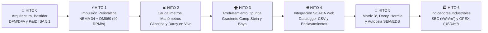

# 💧 PLANTA PILOTO DE ULTRAFILTRACIÓN INDUSTRIAL (FX100) & REACTOR DE COAGULACIÓN-SEDIMENTACIÓN
## Proyecto de Tesis de Grado — Ingeniería Industrial & Química (UNSa 2026)
### Automatización Mecatrónica, Control IoT, Modelado de Transporte en Membranas y Evaluación Industrial

**Tesistas de Grado:** Antonella Guitián & Owen Cañizares  
**Codirector de Tesis:** Ing. Enzo Corte *(Investigador Doctoral — Tesis Doctoral en Procesos de Separación por Membranas)*  
**Institución:** Universidad Nacional de Salta (UNSa) — Facultad de Ingeniería  
**Ubicación de Montaje:** Laboratorio de Ingeniería Química e Industrial — Salta Capital, Argentina  
**Fecha de Consolidación:** Octubre 2026  

---

> [!TIP]
> 🚀 **ACCESO DIRECTO AL FIRMWARE ACTIVO (V6.5 - Producción):**
> El código fuente maestro de producción para el ESP32 (con control de bomba NEMA 34, caudalímetros con blanking, web SCADA y cálculo de Darcy) se encuentra en:
> 👉 **[`02_Hito2_Instrumentacion_Sensores/02_Firmware_Test_Sensores/subhito2_2_v6/EN_USO_firmware_planta/`](./02_Hito2_Instrumentacion_Sensores/02_Firmware_Test_Sensores/subhito2_2_v6/EN_USO_firmware_planta/)**

---

## 🎯 1. Objetivos del Proyecto de Tesis

### 1.1 Objetivo General
Diseñar, construir, instrumentar y validar experimentalmente una **Planta Piloto Automatizada de Tratamiento de Agua para Consumo Humano** que integre un **Reactor Floculador-Sedimentador Cónico** (pretratamiento con biocoagulante natural *Opuntia ficus-indica*) acoplado a un módulo de **Ultrafiltración Capilar de Fibra Hueca (Fresenius CorDiax FX100 de Helixone®)**, supervisado en tiempo real mediante una arquitectura mecatrónica e IoT basada en microcontrolador ESP32 y evaluado bajo indicadores de ingeniería industrial (Consumo Específico de Energía $\text{SEC}$, vida útil de membrana y costos operativos $\text{OPEX}$).

### 1.2 Objetivos Específicos
1. **Modularidad Mecánica y Estructural (DFM/DFA):** Construir un bastidor físico portátil en tres (3) módulos interconectables (Sedimentador, Caja de Filtración 450×450×450 mm con segregación estanca IP65, y Carro de Permeado rodante) que garantice ergonomía, estabilidad dinámica y aislamiento total entre fluidos presurizados y circuitos eléctricos.
2. **Control Cinematográfico de Bombeo (Hito 1):** Controlar una bomba peristáltica MBP-2000 con motor paso a paso NEMA 34 ($4.5\text{ Nm}$) y driver Leadshine DM860 mediante rampa suave determinística ($40\text{ RPM/s}$) e inversión controlada de giro para filtración y retrolavado.
3. **Metrología y Filtrado Anti-EMI (Hito 2):** Instrumentar la medición continua de caudal ($Q_{\text{alim}}, Q_{\text{perm}}$) con sensores de efecto Hall YF-S401 filtrados contra ruido electromagnético de conmutación ($81\text{ Hz}$ eliminado por hardware RC y software), temperatura (DS18B20 OneWire) y presiones manométricas de entrada ($P_1$) y retentado ($P_2$) con manómetros Bourdon amortiguados en glicerina.
4. **Pretratamiento Fisicoquímico Sustentable (Hito 3):** Automatizar el ciclo de floculación en reactor cónico según gradientes de Camp-Stein ($150\text{ RPM}$ rápida / $30\text{ RPM}$ lenta / $0\text{ RPM}$ sedimentación) utilizando biopolímeros extraídos de cladodios de *Opuntia ficus-indica* (tuna), con corte de seguridad por boya de nivel de acero inoxidable.
5. **Supervisión SCADA e IoT Embebido (Hito 4):** Desarrollar un servidor Web SCADA responsivo sobre el ESP32 en SoftAP puro (`http://192.168.4.1`) que ingeste $P_1, P_2, T$, calcule en tiempo real la Presión Transmembrana ($\text{TMP}$) y los parámetros de la Ley de Darcy, exportando dataloggers en `.CSV` con enclavamientos de seguridad física a $0.70\text{ bar}$.
6. **Validación Experimental de Transporte y Autopsia SEM (Hito 5):** Ejecutar una matriz factorial $3^2$ (13 corridas totales incluyendo 3 réplicas en punto central y 1 corrida testigo con agua cruda sin coagulante) para determinar la capa de sacrificio dinámica de *Opuntia*, modelar cinéticas de ensuciamiento de Hermia ($n = 2, 1.5, 1, 0$), ajustar superficies de respuesta (RSM/ANOVA) y realizar la autopsia morfológica de fibras por Microscopía Electrónica de Barrido (SEM/EDS).
7. **Evaluación Tecno-Económica de Escalamiento (Hito 6):** Calcular el Consumo Específico de Energía ($\text{SEC}$ en $\text{kWh/m}^3$), proyectar la degradación irreversible de la membrana ($FRR < 60\%$), optimizar la frecuencia de limpieza química (CIP) y estructurar los costos operativos ($\text{OPEX}$ unitario en $\text{USD/m}^3$) para transferencia tecnológica a comunidades rurales aisladas.

---

## 📊 2. Cuadro Maestro de Estado de Avance por Hito

```
┌────────────────────────────────────────────────────────────────────────────────────────┐
│               ESTADO DE AVANCE CONSOLIDADO DE LA PLANTA PILOTO (UNSa 2026)             │
├──────┬─────────────────────────────────────────────────┬──────────┬────────────────────┤
│ Hito │ Nombre y Alcance Técnico                        │ Avance   │ Estado Actual      │
├──────┼─────────────────────────────────────────────────┼──────────┼────────────────────┤
│ 📁 0 │ Arquitectura General, Estructura DFM y P&ID     │   25%    │ 🟡 En Diseño       │
│ 📁 1 │ Accionamiento NEMA 34 + DM860 (Bomba MBP-2000)  │   70%    │ 🟡 En Ensayos (⚠️) │
│ 📁 2 │ Instrumentación, Filtro RC, Manómetros y Darcy  │   35%    │ 🟡 En Desarrollo   │
│ 📁 3 │ Reactor Sedimentador, Paleta 12V y Opuntia      │   25%    │ 🟡 Especificado    │
│ 📁 4 │ Integración SCADA Web, IoT y Enclavamientos     │    5%    │ ⚪ Solo Plan       │
│ 📁 5 │ Ensayos FX100, Matriz 3², Hermia y Autopsia SEM │    5%    │ ⚪ Solo Plan       │
│ 📁 6 │ Evaluación Industrial: Energía (SEC) y OPEX     │    5%    │ ⚪ Modelos Teóricos│
└──────┴─────────────────────────────────────────────────┴──────────┴────────────────────┘
```

> [!NOTE]
> **Estado Técnico Real de la Planta en Laboratorio (Sinceramiento de Hitos):**
> * **Hito 0 (25%):** Se cuenta con los diagramas conceptuales de flujo y P&ID; la estructura física (bastidor modular de soporte, distribución y segregación) se encuentra **recién en etapa de diseño preliminar**.
> * **Hito 1 (70%):** Accionamiento probado en banco con motor NEMA 34 y driver DM860. **Alerta técnica abierta:** se registran problemas de calentamiento en el motor durante funcionamiento continuo, requiriendo optimización térmica y de corriente.
> * **Hito 2 (35%):** El último firmware preparado (`subhito2_2_v6`) **está pendiente de compilar y validar en el ESP32 real**. Siguiendo la recomendación de Argon, **se descartaron los transductores de presión electrónicos** por deriva/ruido, adoptando manómetros mecánicos de glicerina.
> * **Hito 3 (25%):** Especificación técnica definitiva **cerrada tras auditoría cruzada Antigravity & Argon**. Se definió el motorreductor sinfín-corona 5840-31ZY / limpiaparabrisas ($20 - 35\text{ kg}\cdot\text{cm}$), chumacera KFL08 en tapa con sándwich de Grilón anti-vibración, driver MOSFET BTS7960 (43A) y manguera umbilical con conector GX16-4. Pendiente adquisición y mecanizado en taller.
> * **Hitos 4, 5 y 6 (5% c/u):** **No comenzados a nivel físico.** Se cuenta con la arquitectura de enclavamientos, el plan de ensayos de filtración (matriz $3^2$, Hermia, autopsia SEM) y los scripts teóricos de cálculo de energía y costos en Python.

---

## 🗺️ 3. Mapa de Navegación del Sistema (Flujo Continuo)



---

## 📂 4. Estructura Oficial del Repositorio y Detalle Carpeta por Carpeta

El repositorio ha sido estructurado siguiendo estrictas normas de ingeniería para evitar archivos huérfanos y asegurar que cada componente tenga su memoria técnica y guía correspondiente:

```text
SistemaUF/
│
├── 📁 00_General_y_P_ID_Planta/              ──> 📐 Arquitectura, Bastidor DFM y P&ID ISA 5.1
│   ├── 📁 01_Estructura_y_Montaje_Filtro/    ──> Memoria técnica, maqueta 3D Three.js y fotos
│   ├── 📁 02_Diagrama_PID_y_Filosofia_Control/──> Diagrama P&ID animado, tanques y constantes FX100
│   ├── 📁 03_Organizacion_Equipo_y_Protocolos/──> Roles, protocolo de Git y normas del equipo
│   └── 📄 README.md                          ──> Hub maestro del Hito 0
│
├── 📁 01_Hito1_Control_Accionamiento_NEMA34_DM860/ ──> ⚡ Impulsión y Bomba Peristáltica
│   ├── 📁 01_Hardware_y_Cableado/            ──> Inventario, cableado pin a pin y masas
│   ├── 📁 02_Montaje_y_Optimizacion_Motor/   ──> Conexión 8 cables bipolar serie (3A)
│   ├── 📁 03_Firmware_Control_Bomba/         ──> Firmware de bomba, control Wi-Fi y serie
│   ├── 📁 04_Simulador_Interactivo/          ──> Simulador web interactivo de rampa NEMA 34
│   └── 📄 README.md                          ──> Hub maestro del Hito 1
│
├── 📁 02_Hito2_Instrumentacion_Sensores/      ──> 📊 Metrología, Sensores y Modelo Darcy
│   ├── 📁 01_Guias_Montaje_y_Calibracion/    ──> Guía Subhito 2.4 (Manómetros), manual docx, filtro RC
│   ├── 📁 02_Firmware_Test_Sensores/
│   │   ├── 📁 subhito2_2_v6/                 ──> ⭐ FIRMWARE ACTIVO EN ESP32 (V6.5 - DS18B20 1-Wire, Heap Datalogger, 50 RPM, Darcy)
│   │   ├── 📁 subhito2_2_v4/                 ──> Firmware blindado tras auditoría 4 IAs
│   │   └── 📁 subhito2_2_v3/                 ──> Firmware histórico de probeta
│   ├── 📁 Datos/                             ──> Planillas de calibración en probeta y CSVs
│   └── 📄 README.md                          ──> Hub maestro del Hito 2
│
├── 📁 03_Hito3_Reactor_Sedimentador_Agitador/ ──> 🌪️ Floculación con Opuntia y Agitación
│   ├── 📁 01_Protocolos_y_Teoria_Floculacion/──> Protocolo de Jar Test con biocoagulante
│   ├── 📁 02_Firmware_Control_Agitador/      ──> Firmware FSM para driver Puente H L298N
│   ├── 📁 03_Compras_y_Ferreteria_Hidraulica/──> Accesorios locales en Salta Capital
│   ├── 📁 04_Galeria_y_Montaje_Mecanico/     ──> Guía visual interactiva y fotografías de armado
│   └── 📄 README.md                          ──> Hub maestro del Hito 3
│
├── 📁 04_Hito4_Integracion_Automatizacion_IoT/──> 🌐 Servidor SCADA Web y Enclavamientos
│   ├── 📁 01_Arquitectura_y_Enclavamientos/  ──> Protocolo de seguridad física y lógica
│   ├── 📁 02_Firmware_SCADA_Master/          ──> Sketch maestro unificado con dashboard HTML5
│   └── 📄 README.md                          ──> Hub maestro del Hito 4
│
├── 📁 05_Hito5_Ensayos_Membrana_VidaUtil/    ──> 🧪 Matriz 3², Modelos Hermia y Autopsia SEM
│   ├── 📁 01_Protocolo_Ensayos_Darcy_y_Fouling/──> Protocolo experimental de ultrafiltración
│   ├── 📁 02_Planillas_y_Datos_Tesis/        ──> Plantilla CSV y scripts de graficación
│   ├── 📁 03_Modelado_Hermia_y_Optimizacion_RSM/──> Modelos cinéticos Hermia y ANOVA 3D
│   ├── 📁 04_Autopsia_SEM_EDS_Fibras_Helixone/ ──> Protocolo de microscopía electrónica en N2
│   └── 📄 README.md                          ──> Hub maestro del Hito 5
│
├── 📁 06_Hito6_Evaluacion_Industrial_Energia_Costos/ ──> 🏭 Ingeniería Industrial (SEC y OPEX)
│   ├── 📁 01_Consumo_Energetico_SEC/         ──> Guía de cálculo y script Python de energía
│   ├── 📁 02_Costos_y_Vida_Util/             ──> Guía de vida útil, frecuencia CIP y script OPEX
│   └── 📄 README.md                          ──> Hub maestro del Hito 6
│
├── 📁 Archivado/                             ──> 📦 Códigos históricos y prompts de auditoría
│   └── 📁 Prompts_Auditorias_y_Sesiones/     ──> Registro histórico de prompts y auditorías IA
│
├── 📄 HOJA_DE_RUTA_DESARROLLO_Y_ENSAYOS.md   ──> 🗺️ Metodología experimental y cronograma
├── 📄 MANUAL_GENERAL_Y_GUIA_DE_NAVEGACION.md ──> 🧭 Guía técnica de lectura para tesistas
├── 📄 README.md                              ──> 📖 Este documento maestro
└── 📄 .gitignore                             ──> Exclusiones de control de versiones Git
```

---

## 🔍 5. Contenido Detallado y Función de Cada Carpeta

### 📐 `00_General_y_P_ID_Planta/` *(Avance: 25% — En Diseño Preliminar)*
* **¿Qué ponemos aquí?**: Toda la documentación de diseño previo, arquitectura física, modularidad de chapa, seguridad ocupacional y diagramas maestros de proceso.
* **Situación real**: Se cuenta con los diagramas P&ID y la arquitectura DFM/DFA; la estructura física del bastidor y montaje de módulos se encuentra **recién en fase de diseño**.
* **Archivos clave**:
  * [`01_Estructura_y_Montaje_Filtro/DOCUMENTO_MAESTRO_ESTRUCTURA_FILTRO.md`](./00_General_y_P_ID_Planta/01_Estructura_y_Montaje_Filtro/DOCUMENTO_MAESTRO_ESTRUCTURA_FILTRO.md): Memoria técnica de ingeniería industrial con diseño DFM/DFA de los 3 módulos, análisis de esbeltez de eje de agitación, cálculo de potencia hidrodinámica y aislamiento IP65.
  * [`01_Estructura_y_Montaje_Filtro/guia_visual_estructura.html`](./00_General_y_P_ID_Planta/01_Estructura_y_Montaje_Filtro/guia_visual_estructura.html): Maqueta 3D virtual navegable en Three.js.
  * [`02_Diagrama_PID_y_Filosofia_Control/diagrama_pid_interactivo.html`](./00_General_y_P_ID_Planta/02_Diagrama_PID_y_Filosofia_Control/diagrama_pid_interactivo.html): Diagrama animado interactivo bajo norma ISA-5.1.
  * [`03_Organizacion_Equipo_y_Protocolos/ORGANIZACION_PROYECTO_Y_EQUIPO.md`](./00_General_y_P_ID_Planta/03_Organizacion_Equipo_y_Protocolos/ORGANIZACION_PROYECTO_Y_EQUIPO.md): Marco de gobernanza, roles y flujo de Git.

### ⚡ `01_Hito1_Control_Accionamiento_NEMA34_DM860/` *(Avance: 70% — En Ensayos con Alerta Térmica)*
* **¿Qué ponemos aquí?**: La etapa electromecánica de potencia. Motor paso a paso NEMA 34 acoplado a la bomba peristáltica MBP-2000, driver DM860, transformador y control cinemático por microcontrolador.
* **Situación real**: El accionamiento y rampa fueron probados en banco, pero **persiste un problema de calentamiento en el motor NEMA 34** durante funcionamiento continuo prolongado. Se trabaja en la optimización térmica (ajuste de DIP switches, disipación y ciclo de trabajo).
* **Archivos clave**:
  * [`03_Firmware_Control_Bomba/bomba/bomba.ino`](./01_Hito1_Control_Accionamiento_NEMA34_DM860/03_Firmware_Control_Bomba/bomba/bomba.ino): Sketch oficial de control con interfaz web Wi-Fi.
  * [`02_Montaje_y_Optimizacion_Motor/GUIA_OPTIMIZACION_MOTOR_NEMA34_Y_DIP_SWITCHES.md`](./01_Hito1_Control_Accionamiento_NEMA34_DM860/02_Montaje_y_Optimizacion_Motor/GUIA_OPTIMIZACION_MOTOR_NEMA34_Y_DIP_SWITCHES.md): Puesta a punto en 3200 pulsos/rev y 3.0A serie.
  * [`04_Simulador_Interactivo/simulador_bomba.html`](./01_Hito1_Control_Accionamiento_NEMA34_DM860/04_Simulador_Interactivo/simulador_bomba.html): Simulador web de rampa y disipación térmica.

### 📊 `02_Hito2_Instrumentacion_Sensores/` *(Avance: 35% — En Desarrollo y Ajuste de Firmware)*
* **¿Qué ponemos aquí?**: La instrumentación física, acondicionamiento de señales y firmware en desarrollo para el ESP32.
* **Situación real**: Siguiendo la recomendación técnica de Argon, **se descartaron definitivamente los transductores de presión electrónicos** (por deriva térmica y ruido EMI); la lectura de presiones se realiza con manómetros con baño de glicerina. El último firmware preparado (`subhito2_2_v6`) **aún no se ha compilado ni probado físicamente en el ESP32**.
* **Archivos clave**:
  * [`01_Guias_Montaje_y_Calibracion/Guia_Subhito2_4_Manometros_Glicerina_y_Darcy_SCADA.md`](./02_Hito2_Instrumentacion_Sensores/01_Guias_Montaje_y_Calibracion/Guia_Subhito2_4_Manometros_Glicerina_y_Darcy_SCADA.md): Especificación de manómetros Bourdon de glicerina (inmunes a EMI) e ingesta asistida en SCADA.
  * [`01_Guias_Montaje_y_Calibracion/Diagnostico_y_Resolucion_Problemas_Instrumentacion.md`](./02_Hito2_Instrumentacion_Sensores/01_Guias_Montaje_y_Calibracion/Diagnostico_y_Resolucion_Problemas_Instrumentacion.md): Demostración matemática del filtro de ruido de 81 Hz para el informe de tesis.
  * [`02_Firmware_Test_Sensores/subhito2_2_v6/EN_USO_firmware_planta/`](./02_Hito2_Instrumentacion_Sensores/02_Firmware_Test_Sensores/subhito2_2_v6/EN_USO_firmware_planta/): **FIRMWARE EN DESARROLLO (Pendiente de validación en ESP32)** con módulo Darcy (`darcy.h`), factor TCF de Vogel y exportación CSV ampliada.

### 🌪️ `03_Hito3_Reactor_Sedimentador_Agitador/` *(Avance: 25% — Especificación Cerrada / Pendiente Taller)*
* **¿Qué ponemos aquí?**: El subsistema químico y mecánico de coagulación-floculación en el reactor cónico de **$25\text{ Litros}$**.
* **Situación real**: Especificación técnica cerrada tras dictamen cruzado. Se dispone de la cuba de $25\text{ L}$ en acero inoxidable; pendiente adquisición del motorreductor ($20-35\text{ kg}\cdot\text{cm}$), chumacera KFL08, placa de Grilón y mecanizado excéntrico en tapa.
* **Archivos clave**:
  * [`01_Protocolos_y_Teoria_Floculacion/Protocolo_Ensayo_Coagulacion_Floculacion_JarTest.md`](./03_Hito3_Reactor_Sedimentador_Agitador/01_Protocolos_y_Teoria_Floculacion/Protocolo_Ensayo_Coagulacion_Floculacion_JarTest.md): Extracción de mucílago de *Opuntia*, cálculo de gradiente $G$ para $25\text{ L}$ y ensayo de Jar Test.
  * [`02_Firmware_Control_Agitador/Guia_Dimensionamiento_Motorreductor_y_Torque_Agitador.md`](./03_Hito3_Reactor_Sedimentador_Agitador/02_Firmware_Control_Agitador/Guia_Dimensionamiento_Motorreductor_y_Torque_Agitador.md): **Memoria de cálculo de torque, montaje KFL08 y dictamen Argon**.
  * [`03_Compras_y_Ferreteria_Hidraulica/Lista_Ferreteria_Mecanica_y_Electrica_Agitador_Hito3.md`](./03_Hito3_Reactor_Sedimentador_Agitador/03_Compras_y_Ferreteria_Hidraulica/Lista_Ferreteria_Mecanica_y_Electrica_Agitador_Hito3.md): **Planilla consolidada de compras**: motor 5840-31ZY, chumacera KFL08, acople spider, driver BTS7960 y ficha GX16-4.
  * [`02_Firmware_Control_Agitador/Guia_Control_Agitador_L298N_y_Boya.md`](./03_Hito3_Reactor_Sedimentador_Agitador/02_Firmware_Control_Agitador/Guia_Control_Agitador_L298N_y_Boya.md): Guía de conexionado y transición a driver MOSFET BTS7960.
  * [`04_Galeria_y_Montaje_Mecanico/guia_conexion_sedimentador.html`](./03_Hito3_Reactor_Sedimentador_Agitador/04_Galeria_y_Montaje_Mecanico/guia_conexion_sedimentador.html): Manual interactivo de conexionado y fotos de taller.

### 🌐 `04_Hito4_Integracion_Automatizacion_IoT/` *(Avance: 5% — Solo Planificación Técnica)*
* **¿Qué ponemos aquí?**: La orquestación global del banco de ensayos, seguridad física y supervisión en la nube.
* **Situación real**: **No iniciado físicamente en planta.** Se dispone de la arquitectura teórica de enclavamientos y los borradores de firmware unificado SCADA.
* **Archivos clave**:
  * [`01_Arquitectura_y_Enclavamientos/Guia_Enclavamientos_Seguridad_y_SCADA.md`](./04_Hito4_Integracion_Automatizacion_IoT/01_Arquitectura_y_Enclavamientos/Guia_Enclavamientos_Seguridad_y_SCADA.md): Válvula de alivio a $0.70\text{ bar}$ y paradas de emergencia.
  * [`02_Firmware_SCADA_Master/firmware_planta_completa/firmware_planta_completa.ino`](./04_Hito4_Integracion_Automatizacion_IoT/02_Firmware_SCADA_Master/firmware_planta_completa/firmware_planta_completa.ino): Boceto de firmware SCADA integral con control AJAX e IoT.

### 🧪 `05_Hito5_Ensayos_Membrana_VidaUtil/` *(Avance: 5% — Solo Protocolos de Ensayo)*
* **¿Qué ponemos aquí?**: Toda la campaña de experimentación de ultrafiltración capilar y modelado de ensuciamiento.
* **Situación real**: **No iniciado físicamente.** Existen las metodologías protocolizadas (diseño factorial $3^2$, modelos de Hermia y protocolo SEM), pero aún no se ha ejecutado ninguna corrida experimental en el cartucho FX100.
* **Archivos clave**:
  * [`01_Protocolo_Ensayos_Darcy_y_Fouling/Protocolo_Ensayos_Darcy_y_VidaUtil.md`](./05_Hito5_Ensayos_Membrana_VidaUtil/01_Protocolo_Ensayos_Darcy_y_Fouling/Protocolo_Ensayos_Darcy_y_VidaUtil.md): Protocolo completo de la matriz factorial $3^2$, flujo crítico escalonado y retrolavado hidrostático a $1.20\text{ mca}$.
  * [`03_Modelado_Hermia_y_Optimizacion_RSM/Guia_Modelado_Hermia_y_Superficie_Respuesta.md`](./05_Hito5_Ensayos_Membrana_VidaUtil/03_Modelado_Hermia_y_Optimizacion_RSM/Guia_Modelado_Hermia_y_Superficie_Respuesta.md): Modelos de Hermia ($n = 2, 1.5, 1, 0$) y análisis ANOVA 3D.
  * [`04_Autopsia_SEM_EDS_Fibras_Helixone/Protocolo_Autopsia_SEM_EDS_Membrana_FX100.md`](./05_Hito5_Ensayos_Membrana_VidaUtil/04_Autopsia_SEM_EDS_Fibras_Helixone/Protocolo_Autopsia_SEM_EDS_Membrana_FX100.md): Protocolo de autopsia destructiva en nitrógeno líquido, medición de espesor de torta $\delta_c$ y microanálisis EDS.

### 🏭 `06_Hito6_Evaluacion_Industrial_Energia_Costos/` *(Avance: 5% — Solo Modelos Teóricos)*
* **¿Qué ponemos aquí?**: El cierre tecno-económico y productivo de la Tesis de Grado.
* **Situación real**: **No iniciado con datos reales de planta.** Los scripts analíticos en Python son herramientas preliminares de simulación teórica que serán alimentadas una vez concluidos los ensayos del Hito 5.
* **Archivos clave**:
  * [`01_Consumo_Energetico_SEC/Guia_Calculo_SEC_Consumo_Especifico.md`](./06_Hito6_Evaluacion_Industrial_Energia_Costos/01_Consumo_Energetico_SEC/Guia_Calculo_SEC_Consumo_Especifico.md) + Script [`calculo_sec_matriz13.py`](./06_Hito6_Evaluacion_Industrial_Energia_Costos/01_Consumo_Energetico_SEC/calculo_sec_matriz13.py): Script de estimación de energía y reducción de contrapresión.
  * [`02_Costos_y_Vida_Util/Guia_Vida_Util_Frecuencia_CIP_y_Costos_Operativos.md`](./06_Hito6_Evaluacion_Industrial_Energia_Costos/02_Costos_y_Vida_Util/Guia_Vida_Util_Frecuencia_CIP_y_Costos_Operativos.md) + Script [`evaluacion_industrial_opex.py`](./06_Hito6_Evaluacion_Industrial_Energia_Costos/02_Costos_y_Vida_Util/evaluacion_industrial_opex.py): Script preliminar de OPEX unitario y frecuencia CIP.

---

## 🌐 6. Acceso Rápido al Servidor Web SCADA del ESP32

Para operar la planta piloto en el laboratorio, ingresar a la red Wi-Fi propia generada por el ESP32:

```
                      ┌───────────────────────────────────────────────┐
                      │             CÓMO CONECTARSE AL SCADA          │
                      └───────────────────────────────────────────────┘
                                              │
                      ┌───────────────────────┴───────────────────────┐
                      ▼                                               ▼
         [ MODO 1: Wi-Fi Propio Directo ]               [ MODO 2: Router de Laboratorio ]
         (Operación en banco sin router)                (Notebook conectada a red WiFi)
         • Red Wi-Fi: Bomba_Peristaltica_UF             • Red Wi-Fi: Box804
         • Clave: plantapiloto2                         • Clave: plantapiloto2
         • En tu navegador ingresa a:                   • En tu navegador ingresa a:
           👉 http://192.168.4.1                          👉 http://bomba.local
```

> [!TIP]
> Si te conectas desde un teléfono celular a `Bomba_Peristaltica_UF` y el navegador muestra error de conexión, **desactiva momentáneamente los Datos Móviles (4G/5G)** para obligar al teléfono a resolver la IP local `192.168.4.1`.

---

## 📌 7. Asignación Rápida de Pines del ESP32 DevKit V1

| Pin ESP32 | Función Operativa | Tipo de Señal | Conexión Física de Destino |
| :---: | :--- | :--- | :--- |
| **GPIO 18** | Pulsos STEP Bomba (LEDC) | Salida Digital | Driver Leadshine DM860 (`PUL+` / Ánodo Común 5V) |
| **GPIO 19** | Dirección de Giro (CW/CCW) | Salida Digital | Driver Leadshine DM860 (`DIR+` / Ánodo Común 5V) |
| **GPIO 14** | Caudalímetro FEED (Entrada) | Interrupción IRAM | Placa 2 Front-End (Borne P14 filtrado con RC) |
| **GPIO 27** | Caudalímetro PERMEADO | Interrupción IRAM | Placa 2 Front-End (Borne P27 filtrado con RC) |
| **GPIO 4** | Sensor Temperatura DS18B20 | Bus 1-Wire Digital | Placa 2 Front-End (Borne P4 con Pull-Up $4.7\text{ k}\Omega$) |
| **GPIO 32** | Boya de Nivel Inox (Corte) | Entrada Digital Pull-Up | Placa 2 Front-End (Borne P32 con capacitor 100nF) |
| **GPIO 21** | I2C SDA (Datos) | Bus I2C a 400 kHz | Conversor ADC 16-Bit ADS1115 (Pin SDA) |
| **GPIO 22** | I2C SCL (Reloj) | Bus I2C a 400 kHz | Conversor ADC 16-Bit ADS1115 (Pin SCL) |
| **GPIO 16/17** | Sentido Agitador Jar Test | Salidas Digitales | Driver L298N (Pines IN1 e IN2) |
| **GPIO 5** | Velocidad Agitador (PWM) | Salida PWM 1 kHz | Driver L298N (Pin ENA sin jumper) |

---

## 🐙 8. Flujo de Git para el Equipo

Repositorio oficial: 👉 **[https://github.com/enzoocorte/Planta-Ultrafiltracion](https://github.com/enzoocorte/Planta-Ultrafiltracion)**

1. **Al iniciar la jornada en el laboratorio:** `git pull origin main`
2. **Al realizar calibraciones o registrar datos:** `git add .` y `git commit -m "Hito X: Descripción"`
3. **Al finalizar la jornada:** `git push origin main`
